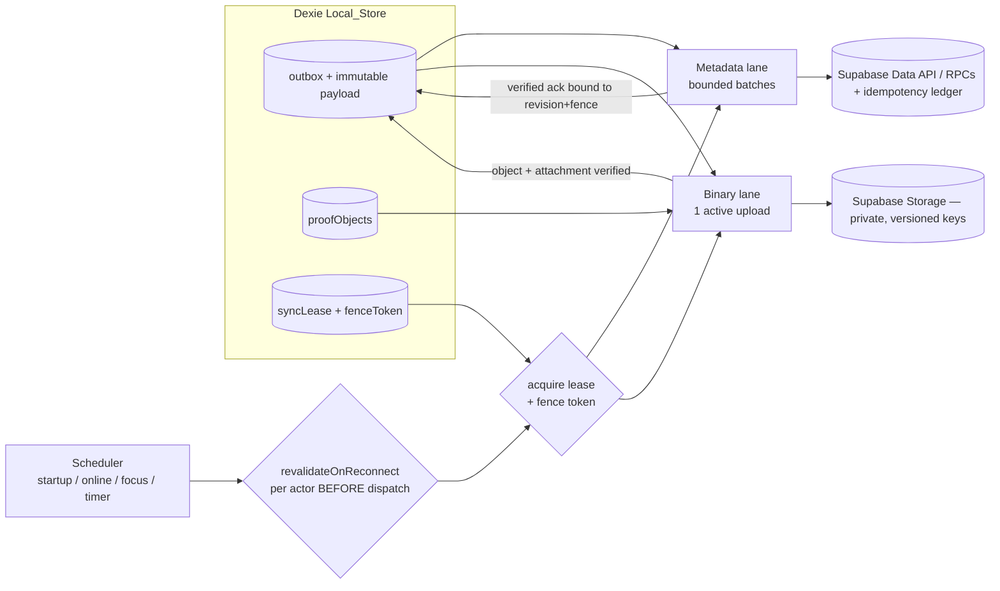
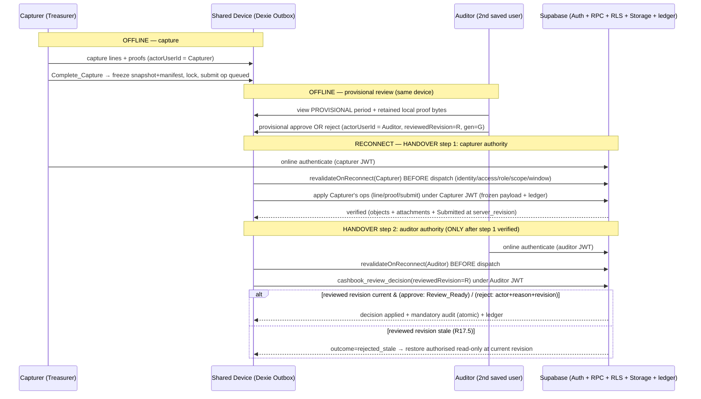

# Design Document — Cashbook Reliability Hardening

> **Spec type:** Hardening / modification of the EXISTING OAC Cashbook app (NOT a rebuild).
> **Phase:** Design (review-gated). This document builds strictly on the approved
> `requirements.md` (R1–R38, NFR-L/C/P/O/R/T, CON-*) and on the ACTUAL repository code. It produces
> **design.md only** — no `tasks.md`, no application code changes, no migrations, no deployment.
>
> **Demo-scoping amendment (this revision):** This revision tracks the amended `requirements.md`. It
> ADDS R33–R38 (Overseer/HO convergence & in-month visibility, submission/sync receipts, sync-staleness
> awareness, authorised provisional read-only visibility, the reliability invariants, and the demo
> online-only review path), CORRECTS the R500 governance design to the ACTUAL **acknowledgement**
> behaviour (R21 / Findings 16, 28; OBD-c, OBD-d), records the `OverseerApproved`/`OverseerRejected`
> status-vocabulary DISCREPANCY (R19.5 / Finding 29 / D-8), and marks the superseded/deferred items
> (SD-1..SD-6 — see §1.6). Same-device offline PROVISIONAL review (R17 and its dependents) is DEFERRED
> post-demo; the demo uses the ONLINE-ONLY review path (R38) that KEEPS offline capture and the
> saved-user picker (§10). No prior design content is deleted — superseded/deferred text is kept and
> labelled in place.
>
> **How to read this document:** Every design element is traced to requirement IDs (R#/NFR/CON) and
> to the Findings (1–29) it addresses. Any element whose correctness depends on something that can
> only be confirmed against the live Supabase project is tagged **`DEPENDS-ON-UNVERIFIED`** and
> cross-referenced to the deployment inspection checklist (§12). The design prefers the CURRENT code
> model (`cashbook_period` / `periodLocalId`) over the obsolete `cashbook_service` / `captureQueue`
> model everywhere (C-1, C-3), and documents that reconciliation explicitly (§2).
>
> **Single submission protocol:** This revision adopts ONE submission/upload protocol end-to-end
> (§2.2a, §5, §6.2, §6.6, §7). Where earlier drafts implied that submit must wait for every proof to
> upload, or that evidence must be fully verified before `Submitted`, those statements are removed.
> The protocol is: Complete_Capture atomically freezes the business snapshot + an **immutable
> Required_Manifest**, creates one Submission_Operation, and locks local editing; the submission RPC
> validates that exact frozen snapshot + manifest, establishes server `Submitted`, and records its
> mandatory audit **atomically**; declared-outstanding proofs may finish uploading **after**
> `Submitted`; `Review_Ready` becomes true only when the submitted snapshot **and** every required
> evidence dependency are verified; formal **approval** requires `Review_Ready`.

---

## 1. Overview

### 1.1 Problem recap

The OAC Cashbook is an offline-first PWA (Vite + React + TS, Dexie, Supabase) that captures weekly
service tithing/offering records, attaches photographic banking proof, and routes each `cashbook_period`
through a governance chain (capture → audit → overseer → HO). The requirements inventory (and this
design's re-reading of source) found the pipeline is **not yet trustworthy at national scale**:

- The sync engine (`src/utils/syncEngine.ts`) **ignores returned errors** on attachment inserts,
  proof-status updates, and audit inserts, yet still nulls local proof blobs and marks the period
  `synced` (Finding 5 — the priority defect; R7/R12).
- There is **no durable operation queue, no Operation_ID, no idempotency, and no immutable operation
  payload** — a lost response after an insert duplicates line items on retry, and the engine
  reconstructs writes by re-reading mutable live rows rather than replaying a frozen payload
  (Findings 4, 7; R6/R11).
- `syncPending()` is invoked from exactly **one** place (`CashbookForm.submit()`, fire-and-forget);
  there is **no startup / reconnect / foreground / scheduler** trigger, interrupted records stick at
  `syncing` forever, and there is **no lease or fence token** so an overlapping/old run can clobber
  newer work (Findings 8, 9, 10; R8/R10/R13).
- Review transitions are a client `UPDATE … .eq("status","Submitted")` followed by a **separate**
  `logAuditAction` — not atomic, not revision-bound, not server-validated beyond an optimistic row
  match (Finding 22; R26). The 4-value `STATUS_RANK` in the engine is not a real transition validator
  and the 7-value `statusFlow.ts` is **not imported by the engine** (Finding 11; R19).
- RLS as scripted is largely `USING (true)` for periods/line-items/audit-log, the attachment policy
  has a broad `scope_level != 'Congregation'` see-all clause with no scoped UPDATE/DELETE or
  parent-lock, and proofs are uploaded with `getPublicUrl` to a bucket whose real name/privacy is
  unconfirmed (Findings 14, 26, 27; R14/R29/R30/R31).
- `revalidateOnReconnect` is **defined but never called** (§2.4 of requirements), so no reconnect path
  re-validates an actor's authority before dispatching that actor's queued work (R13.8/R28.6).
- There is **no server→local hydration** of periods/line-items; capture context depends on a prior
  online login, and a review can combine incompatible revisions (requirements §2.5; R24/R22/R13.9).

This feature hardens **reliability, security, and evidence integrity** without re-architecting roles,
the permission matrix, the hierarchy model, or the capture UX (Exclusion 2).

### 1.2 Goals (and non-goals)

**Goals**
1. **Never lose captured data or evidence.** Local-first persistence of the transaction mutation, its
   **immutable Outbox_Op payload**, and the proof bytes, all atomically; proof bytes retained until a
   verified upload + verified object + confirmed attachment for the exact revision, and retained for
   same-device offline review beyond transfer (R1, R7, R12, R17.8, CON-STORAGE1).
2. **Never duplicate logical work after retries / lost acknowledgements.** Stable, immutable
   Operation_IDs + an immutable operation payload + a server-side **idempotency ledger** keyed by
   Operation_ID + retry-safe application that returns the recorded result (R6, R11).
3. **Recover automatically and safely.** Atomic worker leases with **fence tokens** + startup /
   reconnect / foreground resume + a real scheduler with capped backoff + jitter + `Retry-After`;
   fencing prevents a resumed/overlapping worker from clobbering newer work (R8, R9, R10, R13).
4. **Make review safe and correctly separated.** Atomic, server-validated approve/reject/reopen bound
   to the reviewed revision + actor + mandatory audit record, with **distinct prerequisites** per
   decision type (approval needs Review_Ready; rejection needs only actor + reason + revision; reopen
   is HO-only and creates a new Capture_Generation); fail-closed on partial loads; scoped attachment
   loading and explicit current-version resolution (R16, R24, R25, R26).
5. **Enforce access server-side with operation-specific authority.** Replace `USING (true)` with
   hierarchy-scoped RLS + retry-safe RPCs that perform internal actor/role/scope checks; HO-only
   administration keeps its HO gate; private proofs with scoped access; close dormant Phase B–D
   exposure (R29, R30, R31, R14, CON-SEC2).
6. **Isolate shared-device actors with reconnect re-validation.** Each actor's queued work is applied
   under THAT actor's own authenticated authority via an explicit handover sequence; reconnect
   re-validates identity, active access, role, hierarchy scope, and access window **before** dispatch
   (wiring the currently-dead `revalidateOnReconnect`); no delegation, no cross-actor replay (R28, R17,
   R18, R13.8).
7. **Measure, don't assert, capacity.** A measurement plan + a cost model built from measured
   mean/total retained bytes + a whole-period latency expectation alongside the per-transaction
   2-minute business requirement + staged, authorised load tests (NFR-C, NFR-O, NFR-P, NFR-L, NFR-T).

**Agreed Principles (govern every goal above):**
- **P1 — reconfirm, don't silently change.** Where behaviour, vocabulary, or a business rule is
  ambiguous or discrepant, the design RECONFIRMS it as a recorded finding/decision and does NOT silently
  alter working logic (realised throughout §2.4, §2.7, §6.10, and the OBD-*/SD-* items in §1.6).
- **P2 — existing server-side enforcement is demo-critical.** Existing server-side enforcement, private
  proofs, authenticated actor attribution, and state locking are treated as demo-critical and are
  preserved/hardened, never relaxed (realised in §6, §7.4, §8.4, §10.6).

**Non-goals (Exclusions):** no new backend/storage platform; no Azure storage/SSO; no ZIP exports; no
sponsored-data; no rebuild of roles/matrix/hierarchy/UX; Phase B–D stays dormant (only exposed access
is fixed); no automatic retention/deletion; no hot/cool tiering (deferred); no automatic historical
purge; the obsolete `cashbook_service` schema is NOT authoritative.

### 1.3 Decisions adopted (locked by the user — the design conforms to these exactly)

| # | Decision | Where realised |
|---|----------|----------------|
| **D1** | **Single submission protocol.** Complete_Capture atomically freezes the business snapshot + the immutable Required_Manifest, creates exactly one Submission_Operation, and locks local editing immediately (mapped to the existing `Submitted` status — no new business status). The submission RPC validates that exact snapshot + manifest, establishes `Submitted`, and records its mandatory submission audit atomically. Declared-outstanding proofs finish uploading AFTER `Submitted`. `Review_Ready` (and therefore formal approval) requires the submitted snapshot AND all required evidence verified. Business_State stays separate from Transfer_State and from Review_Ready. | §2.2, §5, §6.2, §6.6, §7 |
| **D2** | **Shared-device identity = actor-specific authenticated replay with EXPLICIT HANDOVER + reconnect re-validation.** Each actor's queued ops applied under that actor's own server authority; capturer's actions never sent under the auditor's JWT. On reconnect, `revalidateOnReconnect` re-validates identity/access/role/scope/window BEFORE dispatching that actor's ops. Provisional APPROVAL and provisional REJECTION are separate flows, each re-validated under its own actor. Device_ID is correlation only; never store passwords for replay; no offline-PIN non-repudiation; NO delegation mechanism. | §10, §3, §8 |
| **D3** | **Latency: two reported measures.** The **2-minute proof-ready expectation is the business requirement** (NFR-L1); a **whole-period Complete_Capture → Review_Ready** expectation is reported ALONGSIDE it (NFR-L3). Metadata-only visibility carries the adopted engineering target **p95 ≤ 2s** under defined conditions (NFR-L2). Report user-perceived elapsed time and transfer time SEPARATELY, with offline-wait and reauth-wait broken out; report p50/p95/p99 AND max; never reset the clock after an arbitrary delay. | §13, §14 |
| **D4** | **Retain private Supabase Storage. DEFER hot/cool tiering** (measure growth/cost first; no auto-deletion, no recompression of approved evidence). EXCLUDE Azure storage/SSO and ZIP exports. Keep storage ops behind a MODEST, replaceable **storage port**. | §7, §11, §13 |

### 1.4 Prioritisation (drives §-sequencing and the tasks phase)

Fix reliability/safety FIRST; optimise concurrency LAST:

1. **Evidence preservation + error-checked acknowledgement** (R7/R12 — Finding 5 priority defect) → §3, §5, §7.
2. **Immutable operation payload + stable Operation_IDs + server idempotency ledger** (R6/R11) → §3, §5, §6.
3. **Recoverable worker leases with fence tokens + startup/reconnect/focus recovery** (R8/R10/R13) → §4, §8.
4. **Atomic server-validated decisions with revision + actor + mandatory audit; separated approve/reject/reopen** (R16/R19/R26) → §6.
5. **Server-enforced editable/locking + scoped RLS/RPC with operation-specific authority** (R3/R26/R28–R30) → §6, §7, §12.
6. **Scoped hydration with explicit merge rules + bounded dashboard refresh + WIP incl. DRAFT** (R23/R24/R13.9) → §9.
7. **THEN concurrency optimisation.** Capped backoff + jitter + `Retry-After` are specified (§4) but
   secondary. Default **one active proof upload per device** initially, configurable from measurement;
   **no fixed per-file delays** (NFR-C3/C4).

**Ordering / FEATURE-GATE dependency (delivery constraint).** Actor-specific authentication checks and
reconnect authorisation revalidation (item 6 above; §4.3, §8, §10.4/§10.6, wiring `revalidateOnReconnect`)
MUST be implemented AND tested **before** automatic/progressive synchronisation (the §4.3 SyncController
scheduler + the §4.1/§5 progressive lanes) is ENABLED. Until actor-scoped auth replay + reconnect
revalidation are complete and tested, automatic/progressive sync stays **behind a feature gate** so no
intermediate build can drain another saved user's queued work under the wrong JWT (the outbox is
actor-scoped; dispatch is paused per-actor until that actor's own authenticated connectivity is
revalidated). See the FEATURE-GATE statement in §4.3.

### 1.5 Traceability note

Each subsection header carries the requirement IDs and Findings it realises. §15 (Correctness
Properties) and §17 (Testing Strategy) map the requirements' Acceptance-Test Coverage Map to design
elements. Every element that depends on live-only facts is tagged `DEPENDS-ON-UNVERIFIED` and listed
in §12. No design element asserts a deployed-security fact as true.

### 1.6 Superseded & Deferred (post-demo) — do NOT implement in this phase

Mirrors the requirements' "Superseded & Deferred (post-demo)" subsection (SD-1..SD-6). These items are
explicitly NOT built in this phase. Where earlier design drafts or the amendment brief implied them,
the text is RETAINED and labelled **SUPERSEDED** / **DEFERRED** in place — nothing is deleted — so the
decision is on the record. The design KEEPS the legitimate reliability constructs listed at the end.

| Item | What it would have been | Status in this design | Where labelled |
|------|-------------------------|-----------------------|----------------|
| **SD-1 — Congregation-month LOCK TABLE** | A dedicated per-congregation-month lock table | **SUPERSEDED (deferred post-demo).** Month locking is expressed through Business_State — `SubmittedToHO` is the final month lock, HO-only unlock. **No lock table is introduced** (§6.1 introduces none; §2.4/§6.5/§9.6). | §2.4, §6.5, §9.6 |
| **SD-2 — Authenticated Elder APPROVAL binding** | An operation-ID-bound authenticated Elder approval / acknowledgement workflow | **SUPERSEDED (deferred post-demo); OBD-c stays OPEN.** The capture-time comment stays RECORDED TEXT; no authenticated-approval or operation-ID-bound Elder workflow is designed (§2.7). | §2.7, §18 |
| **SD-3 — Expense-specific PARTIAL UNIQUE INDEX / new expense table** | A new expense table and/or an expense-specific partial unique index | **SUPERSEDED (deferred post-demo).** Anti-duplication is expressed as a testable invariant (R37) realised by the Operation_ID ledger + server revision compare-and-set + natural keys — **no new expense table, no expense-specific partial index** (§5.3, §6.1, §8.4). | §5.3, §6.1, §8.4 |
| **SD-4 — New MONTH-COMPLETION DECLARATION** | A new month-completion declaration artefact | **SUPERSEDED (deferred post-demo).** Existing month-completion controls are preserved; **no new declaration artefact** (§2.8, §6.5). | §2.8, §6.5 |
| **SD-5 — New MONTHLY expense-aggregation binding** | A new monthly expense-aggregation rule | **SUPERSEDED (deferred post-demo); OBD-b stays OPEN.** The CURRENT per-period behaviour of `monthlyExpensesExceedThreshold` is preserved as a proposal, not an approved new rule (§2.7). | §2.7, §18 |
| **SD-6 — Same-device offline PROVISIONAL review (R17 + dependents)** | Same-device offline provisional audit (unwired in source — Findings 12/13) | **DEFERRED post-demo (separately scoped).** §10 is retained under a DEFERRED banner for future use; the demo uses the ONLINE-ONLY review path (R38, §10.0). Actor-specific authenticated replay + explicit handover for CAPTURE sync (R28 core) are **NOT** deferred and remain demo-critical. | §10 (banner), §10.0 |

**Legitimate reliability constructs KEPT (not superseded):** the durable outbox + immutable operation
payload (§3), the Operation_ID + `cashbook_op_ledger` idempotency ledger (§5.3), the submission manifest
(§2.2.1, §6.1), the proof version registry (`cashbook_proof_version`, §6.1/§7.6), the object
verification records (`cashbook_proof_verification`, §6.1/§7.5), and review-decision atomicity
(`cashbook_review_decision`, §6.1/§6.3). None of §6.1's authoritative tables is a month-lock table or an
expense index artefact, so none requires a SUPERSEDED mark.

---

## 2. Architecture — Local ↔ Server state mapping + submission protocol (R15, R16, R19; C-2; Findings 11, 12, 15, 29)

### 2.1 Three orthogonal state axes (CON-STORAGE2)

The core architectural correction is to stop conflating three things the current code mixes into one
`LocalPeriod.status` + `localStatus` pair:

- **Business_State** — governance status of a period. Local vocabulary is the real 4-value
  `PeriodStatus = Draft | Rejected | Submitted | AuditApproved` (`src/db/schema.ts`). The fuller 7-value
  server `ServiceStatus = Draft | Submitted | AuditApproved | SubmittedToOverseer | Rejected |
  SubmittedToHO | HOReviewed` (`src/lib/types.ts`) governs the month/Overseer/HO chain.
- **Transfer_State** — reliability/sync status, independent of Business_State: `metadata-pending`,
  `proof-uploading`, `verified`, `auth-required`, `conflict`, `permanent-error`. Today this is crudely
  carried by `LocalSyncStatus = pending|syncing|synced|conflict|failed` on the whole period; the
  design moves it to **per-operation** Transfer_State (§3) and keeps a derived period-level roll-up for
  the UI.
- **Review_Ready** — a server-computed condition (NOT a status) that is true ONLY when the submitted
  frozen snapshot AND every required evidence dependency in the server-confirmed Required_Manifest are
  verified against the latest acknowledged revision; formal approval requires it (R16).

These three axes are modelled separately in both the local store (§3) and the server contract (§6). The
UI derives its labels from the combination (e.g. "Submitted — uploading proofs (3 of 5)", "Submitted —
waiting for your sign-in", "Submitted — ready for audit").

### 2.2 The single submission protocol end-to-end (D1; R15.1–R15.8, R16; Findings 11, 15)

This is the one protocol used everywhere; §4, §5, §6, and §7 implement its stages without contradiction.
There is no step at which "submit waits for all proofs to upload" and no step at which "evidence must be
fully verified before `Submitted`". The stages are:

**(a) Atomic freeze + lock (local).** When the capturer invokes "Complete Capture and Submit for Audit"
(the renamed "Submit for Audit"), the existing governance gates run unchanged — balanced
(`isBalanced`), income > 0, proof-completeness (corrected per R20, §2.6 — each required proof present
**locally or legitimately exempt**, NOT every object uploaded), and the per-period expense over-threshold
Elder-comment ACKNOWLEDGEMENT gate (R21, §2.7 — preserved as-is, not moved or changed). In a **single Dexie transaction** the Capture_App then: freezes the period's business
snapshot; computes and freezes the **immutable Required_Manifest** (contents in §2.2.1); creates exactly
one durable `submit` Submission_Operation carrying that frozen snapshot + manifest as its **immutable
payload** (§5.2); bumps the period to a new `entityRevision`; and flips Business_State `Draft|Rejected →
Submitted`, locking the period to display-only immediately (R15.2, R15.3). Progressive transfer of
individual transactions/proofs is NOT gated on this action — metadata and proofs stream earlier via
their own ops (R15.4, R5).

**(b) Frozen-snapshot transfer.** The Sync_Engine transfers the submission op by replaying its **frozen
payload** (§5.2) — it never re-reads mutable live rows to reconstruct an older revision. All metadata of
the frozen snapshot (transaction identities + revisions, manifest) transfers as captured.

**(c) Atomic server submission.** The submission RPC (`cashbook_submit_period`, §6.2) validates the
EXACT frozen snapshot + manifest against server state, establishes server `Submitted`, and records the
mandatory submission audit **atomically (all-or-nothing)**. If snapshot/manifest validation or the audit
write fails, `Submitted` is NOT established (R15.6, R7.4). The RPC is idempotent on the Operation_ID via
the idempotency ledger (§5.3): a replay returns the recorded result, never a second transition.

**(d) Post-submit evidence finalisation (declared only).** A proof that was **declared outstanding in
the manifest** but whose object had not finished uploading at submission time may finish
uploading/finalising AFTER `Submitted` (R15.7). Only the narrowly authorised creation/finalisation of
these declared-outstanding proofs is permitted post-submit. **Undeclared additions, object overwrite,
proof replacement, and business edits are blocked** (R14.5, R29.4) — enforced by the manifest check in
the finalisation RPC (§6.7) AND by storage object policies (§7.4), not by UI alone.

**(e) Review_Ready.** `Review_Ready` becomes true only when the submitted snapshot AND every required
evidence dependency in the manifest are **verified** (object existence + byte integrity + server content
validation, §7.5), evaluated at the latest acknowledged revision (R16.1, R16.4). Until then the period
is presented (where authorised) as provisional WIP and is NOT formally approvable (R16.2, R23.3).

**(f) Formal approval.** Formal approval requires `Review_Ready` plus the balanced submission, the
current submitted revision, and the four-section verification (R16.6, §6.3). Rejection does **not**
require these (§6.3, R26.7).

**Interrupted uploads, rejection during transfer, reopened generations:**
- An **interrupted upload** of a declared-outstanding proof is simply retried (same `proofId`+`revision`
  → same object key, §5.4/§7); it never changes the frozen snapshot and never alters already-verified
  evidence.
- A **rejection that arrives while declared proofs are still transferring** is still a valid rejection
  (rejection prerequisites are only actor + reason + reviewed revision — §6.3/R26.7); in-flight
  declared-proof finalisations for that period are superseded, and the capturer corrects under a new
  Capture_Generation if a reopen is authorised (§2.5, §6.4).
- A **reopened Capture_Generation** creates a new generation marker (§2.9); earlier evidence and
  decisions are preserved and never conflated with the later generation (R19.4, R26.8). A new submission
  freezes a new manifest bound to the new generation.

#### 2.2.1 Immutable Required_Manifest — concrete contents (R15.8)

The manifest is computed once at freeze and is immutable for that frozen snapshot. It enumerates
concretely:

| Manifest field | Meaning | Source at freeze |
|----------------|---------|------------------|
| `submissionOpId` | the Submission_Operation / Operation_ID (submission identity) | generated at freeze |
| `periodLocalId` + `periodServerId?` | the period identity (server id if already mapped) | local row + id map (§5.1) |
| `captureGeneration` | the Capture_Generation this submission belongs to | period generation counter |
| `periodRevision` | the period `entityRevision` frozen at submit | period row |
| `transactions[]` | each `{ lineLocalId, lineServerId?, revision }` — transaction identities + revisions | line rows |
| `expectedProofs[]` | each `{ proofId, version, lineLocalId, status: declared-present\|declared-outstanding }` | `proofObjects` |
| `depositSlips[]` | each `{ proofId, version, coveredLineLocalIds[] }` — shared deposit-slip coverage | `proofObjects` |
| `exemptions[]` | each `{ lineLocalId, reason: cash\|… }` — legitimate proof exemptions | exemption rules (§2.8) |

The manifest is persisted (frozen) inside the submission op payload (§5.2) and is the authoritative
checklist for `Review_Ready` (§6.6). The server stores its own copy in `cashbook_submission_manifest`
(§6.1) at submission time so Review_Ready is computed from server-confirmed data, not client assertion.

### 2.3 Representing a locked-but-pending period

A period's displayed condition is the tuple `(Business_State, period-level Transfer roll-up, Review_Ready)`:

| Business_State | Transfer roll-up (derived from ops) | Review_Ready (server) | UI meaning |
|---|---|---|---|
| `Draft` | `metadata-pending` / `proof-uploading` | n/a | editable, syncing progressively |
| `Submitted` | `proof-uploading` | `false` | **locked**, declared proofs still arriving — WIP, not approvable |
| `Submitted` | `auth-required` | `false` | **locked**, waiting for the actor's online sign-in (§10) |
| `Submitted` | `verified` | `true` | **locked**, ready for formal audit |
| `AuditApproved` / `Rejected` | `verified` | n/a | closed / returned for correction (new generation) |

### 2.4 Reconciling the 4-value local vocabulary with the 7-value server flow (C-2; R19; Finding 11)

The engine today validates transitions with a 4-key `STATUS_RANK` and never imports `statusFlow.ts`.
The design makes `statusFlow.ts` (the canonical 7-value directional validator, `isValidTransition` /
`isDownstreamOf` / `statusRank`) the single source of truth for **every** Business_State transition the
sync path applies, extended so unknown/advanced statuses rank correctly rather than defaulting to Draft:

- Local writes propose only `Draft→Submitted` (capture) and, via the review path (§6.3),
  `Submitted→AuditApproved|Rejected`. These are validated against `statusFlow.ts` for the **server**
  vocabulary, not the 4-value rank.
- **Conflict detection** uses `isDownstreamOf(serverStatus, localCapturedStatus)` over the full 7-value
  order. If the server is at `SubmittedToOverseer`/`SubmittedToHO`/`HOReviewed`, those rank **above**
  `AuditApproved` and are therefore downstream — the local write is recorded as a conflict and never
  applied (R19.2, R11.4). The current `STATUS_RANK[server] ?? 0` fallback is the exact bug this fixes.
- The month / Overseer / HO workflow is preserved (`recomputeMonthStatus`, `bulkSubmitMonthToOverseer`,
  `MonthStatus`), with month-completion gaining a server-validated expected-period check (§6.5, R27).
- Corrections / month-unlock remain **HO-only** (R19.3), enforced in `statusFlow.ts` (`PrivilegedAction`)
  and server-side in the reopen RPC (§6.4).

**Month sequencing — reconciling the ACTUAL deployed states (R27.5, R33, R19.3; Finding 29):** sequencing
is expressed through the period's Business_State, NOT a dedicated lock table (SD-1):
- **Capture submitted for audit** (`Submitted`) restricts edits per the existing audit workflow (§2.5) —
  the period is display-only until a decision or an authorised reopen.
- **Month submitted to the Overseer** is the SERVER `SubmittedToOverseer` state (written by
  `ChairpersonDashboard.handleSubmitAll` / `bulkSubmitMonthToOverseer`, logging MONTH_SUBMIT +
  SELF_REVIEW_EXCEPTION). A **local pending/queued** state does NOT satisfy the prerequisite for
  advancing the next month where month sequencing applies — only the server `SubmittedToOverseer` state
  does (R27.5).
- **Overseer → HO** is the SERVER `SubmittedToHO` state (handled in `src/review/OverseerReview.tsx` →
  `src/review/HOReview.tsx`); `SubmittedToHO` is the **final month lock**, and **only HO may unlock or
  correct** a locked month (R19.3, R33.5). A read-only HO/Overseer in-month visibility query does NOT
  auto-unlock a month and alters no Business_State (R33.4, §9.6).

**Status-vocabulary DISCREPANCY — `OverseerApproved` / `OverseerRejected` (R19.5 / Finding 29 / D-8):**
`src/review/OverseerReview.tsx decide()` WRITES `status: "OverseerApproved"` / `"OverseerRejected"` and
its buckets filter on them, but these values are ABSENT from both the `ServiceStatus` enum
(`src/lib/types.ts SERVICE_STATUSES`) and the `statusFlow.ts` validator (whose `SubmittedToOverseer`
successors are only `SubmittedToHO` / `Rejected`). This design RECORDS this as a status-vocabulary
discrepancy requiring a **separate decision (D-8, §18)** and does **NOT silently adopt either
vocabulary**. The transition validator (`statusFlow.ts`) and the transition RPCs (§6) MUST be reconciled
to the **deployed** `cashbook_period.status` enum **before any status change is applied**
(`DEPENDS-ON-UNVERIFIED` — §12 base table shape + constraints). No code change to the Overseer surface
is prescribed in this phase.

> `DEPENDS-ON-UNVERIFIED`: the **exact deployed `cashbook_period.status` CHECK/enum vocabulary** —
> including whether `OverseerApproved`/`OverseerRejected` exist server-side — and whether a server-side
> status column constrains these values (§12 — base table shape + constraints). The transition RPCs
> (§6) and `statusFlow.ts` must be reconciled to the deployed enum before deployment (D-8).

### 2.5 Server- and repository-enforced editability (R3; Finding 3)

Editability is enforced at **three** layers so UI gating is never the only protection:

1. **Capture_App data layer** — `captureRepo` mutations (`addLineItem`, `updateLineItem`,
   `deleteLineItem`, `setIncomeType`, `attachProof`, `markCashBanked`) call `isPeriodEditable(period)`
   and reject with a typed error when the period is `Submitted`/`AuditApproved`, independent of UI
   gating (R3.1, R3.3). Today none of them do.
2. **Local lock on submit** — Complete_Capture flips Business_State and the UI renders display-only (R3.2).
3. **Server-side** — RLS `WITH CHECK` and the mutation RPCs reject writes to a non-editable period's
   rows (R3.4, traced to R29/§6/§7), so a direct Data-API write or a stale tab cannot mutate a locked
   period.

### 2.6 Correct proof-completeness semantics (R20; Finding 16)

`hasProofLocally` today returns true for `proof_status === "Pending"` **with no blob**. The design
redefines proof-presence for the current revision as: **a local proof Blob exists OR a verified proof
object + confirmed `cashbook_attachment` exists for the current transaction revision** (R20.1). A
`Pending` status with no blob never satisfies a proof requirement (R20.2). At Complete_Capture,
proof-completeness means each required proof is **present locally or legitimately exempt** — it does NOT
require every object to have finished uploading (R15.1). Complete_Capture is blocked and the affected
transactions identified when a mandatory proof is absent (R20.3). Legitimate exemptions are preserved
(cash via the deposit slip, §2.8).

### 2.7 Expense over-threshold ACKNOWLEDGEMENT gate — preserve current behaviour (R21; Findings 16, 28; U-M5)

> **This phase describes and preserves the ACTUAL behaviour. It does NOT move the gate, does NOT change
> the aggregation scope, and does NOT turn the comment into an authenticated approval. The three
> discrepancies below are recorded as FINDINGS for a separate decision (OBD-b/-c/-d, §18).**

**Confirmed in source (grounded facts):**
- The gate fires at the **PER-PERIOD "Submit for Audit"** action in `CashbookForm.submit()`
  (`if (over500 && !elderComment.trim()) …` then `capture.submitPeriod`). It is NOT at month submit-to-
  Overseer; `ChairpersonDashboard.handleSubmitAll` sets `SubmittedToOverseer` and logs
  MONTH_SUBMIT + SELF_REVIEW_EXCEPTION with **no comment** required.
- It is an **ACKNOWLEDGEMENT** — awareness / a recorded reason-for-escalation to the Overseer/HO / a
  deterrent — **NOT an approval**. Over-threshold expenses are **HIGHLIGHTED** (amber banner "Expenses
  exceed R500 — Elder approval comment required before submission") and do **NOT stop capture** of
  further transactions.
- `monthlyExpensesExceedThreshold(items, threshold)` in `src/lib/captureTotals.ts` sums only
  `expensesTotal(items)` of the items passed — i.e. it is **PER-PERIOD** (current period's captured
  items), **not** monthly, despite the name. `const R500 = 500` is hardcoded in `CashbookForm`;
  `congregation_settings.expense_approval_threshold` (exists per `migration_elder_features.sql`, default
  500) is **unused**. The field is named `elderApprovalComment` / placeholder "Elder approval comment *".

**Design treatment for R21 (preserve, do NOT fix here):**
- **(R21.1)** While the current period's expenses exceed the threshold, the Capture_App HIGHLIGHTS the
  condition and does NOT block capture. **Discrepancy (do NOT fix here):** `R500` is hardcoded and the
  configurable `congregation_settings.expense_approval_threshold` is unused (Finding 16); whether to
  source the configurable threshold is an OPEN decision — not sourced in this phase.
- **(R21.2 / OBD-b / SD-5)** The design PRESERVES the CURRENT **per-period** aggregation of
  `monthlyExpensesExceedThreshold`. Per-month vs per-period is an OPEN business decision and is NOT an
  approved new business rule; no new monthly expense-aggregation binding is introduced (SD-5). The
  method name implies monthly but the code sums only the current period (Finding 16).
- **(R21.3 / OBD-d)** The mandatory acknowledgement comment is required before the capturer's PER-PERIOD
  Submit-for-Audit / Complete_Capture step — exactly where it fires today. **Discrepancy (do NOT fix
  here):** the business description expects acknowledgement before *month submit-to-Overseer*, while the
  gate is at per-period Submit-for-Audit (Finding 28); the gate LOCATION is NOT moved in this phase
  (OBD-d, §18).
- **(R21.4 / OBD-c / SD-2)** The comment is treated as **RECORDED TEXT entered during capture**, not as
  authenticated Elder approval, even though the field is labelled `elderApprovalComment`. The design does
  **NOT** introduce a new authenticated Elder workflow, an operation-ID-bound Elder approval, or a new
  monthly aggregation. Whether the comment should become an authenticated Elder approval is OBD-c and is
  DEFERRED post-demo (SD-2, §18).

**Three recorded discrepancies (findings for separate decision):** (i) gate LOCATION — per-period
Submit-for-Audit vs the before-submit-to-Overseer expectation (OBD-d); (ii) the code's "approval" LABEL
vs the acknowledgement INTENT (OBD-c); (iii) per-period `monthlyExpensesExceedThreshold` + the unused
configurable threshold (OBD-b, Finding 16). None is fixed in this phase.

### 2.8 Preserved business rules (documented, intact)

Kept unchanged; must survive hardening:
- **Balancing:** `income (Members+Officers+Burial) === banked (EFT+DirectDebit+CashBanked) + expenses`,
  at cent precision (`isBalanced`).
- **Cash-proof exemption:** `Cash`/`CashBanked` items carry no individual proof; a single shared
  Deposit_Slip (one object) covers all banked cash + burial items (`markCashBanked`, §5.5). `needsProof`
  excludes cash types. These exemptions are enumerated in the manifest `exemptions[]` (§2.2.1).
- **Expense over-threshold ACKNOWLEDGEMENT** Elder-comment governance — preserved per-period behaviour
  with the hardcoded `R500` and unused configurable threshold recorded as discrepancies (§2.7).
- **OAC calendar / month workflow:** Week 1 = 2nd Sunday; last week = 1st Sunday of next month
  (`oacWeeks.ts`, `get_or_create_period`); month machine Open → AllWeeksClosed →
  MonthSubmittedToOverseer → SubmittedToHO (R27, §6.5). **No new month-completion DECLARATION artefact
  is introduced (SD-4); the existing month-completion controls are preserved** — the design only adds a
  server-validated expected-period check to the EXISTING flow (§6.5), it does not add a new declaration
  step.
- **AM / PM services treated independently (R27.6; OBD-a):** AM = morning, PM = evening / late-afternoon.
  **Absence of capture for either or both services for a week is PERMITTED**, SHALL NOT be manufactured
  into a mandatory AM/PM record, and SHALL NOT hinder next-week capture. The design does **NOT** add a
  `has_pm_service` config and does **NOT** fabricate mandatory AM/PM records. "**service-did-not-occur**"
  is kept DISTINCT from "service-occurred-with-no-tithing" (`R0_Confirmation`), and an `R0_Confirmation`
  still requires normal audit approval before month advancement (R27.2, §6.5). **The exact expected
  AM/PM service calendar rule remains a BUSINESS DECISION requiring confirmation (OBD-a, §18) — not
  silently fixed here.** Any gap between intended governance and the existing behaviour is recorded as a
  FINDING for separate decision, not changed in this phase.
- **HO-only corrections / month-unlock** (R19.3).
- **Secretary totals-only, permission-matrix gating, HO district segregation** — unchanged (Exclusion 2).

### 2.9 Capture_Generation (R19.4, R26.8)

A period carries a monotonic `captureGeneration` counter. A `Draft` capture is generation 1. An
authorised reopen/correction (HO-only, §6.4) increments the generation, creating a fresh editable cycle
whose future submission freezes a new manifest bound to the new generation. Evidence, manifests, and
decisions from earlier generations are **preserved** and never conflated with the later one (prior proof
objects remain immutable; prior audit rows remain). `Review_Ready` and approval always evaluate the
**current** generation's submitted snapshot.

---

## 3. Data Models — Durable local outbox + immutable operation payload (CON-STORAGE1–4; R1, R2, R7, R10, R11, R12, R28, R32; Findings 1, 2, 5, 7, 8)

### 3.1 Design principle: a durable, actor-scoped Outbox with a frozen payload

The root cause of Findings 1/5/7/8 is that the engine derives "what to sync" by scanning `db.periods`
for `localStatus ∈ {pending, failed}` and performs multi-step server work with no durable record of
*what operation* is in flight, *under whose authority*, *against which revision*, or *with what exact
content*. The design introduces a **durable Outbox** of fine-grained operations persisted **atomically
with** the business mutation that produced them (CON-STORAGE1), and each operation carries an
**immutable serialized payload** so the Sync_Engine replays the frozen content rather than re-reading
mutable live rows. The Outbox is the single source of truth for the Sync_Engine; the period/line rows
remain the business data.

### 3.2 Revision ownership model (R10.4, R11, R19.4; new)

Four distinct version concepts are kept explicit and never collapsed:

| Concept | Owner | Scope | Purpose |
|---------|-------|-------|---------|
| **Client revision** (`entityRevision` / line `revision`) | the capturing client | per entity, per device | monotonic; bumped on every local business mutation; used for local dirty-tracking and for fencing stale acknowledgements (§8.2) |
| **Server revision** (`server_revision`) | the server (RPC compare-and-set) | per entity, authoritative | monotonic server-side; the value a decision/approval binds to; stale metadata writes are rejected by expected-version check (§6) |
| **Capture_Generation** (`captureGeneration`) | server + mirrored locally | per period reopen cycle | separates reopened/corrected cycles so evidence/decisions never conflate across generations (§2.9) |
| **Submitted-snapshot identity** (`submissionOpId` + `periodRevision`) | frozen at Complete_Capture | per submission | identifies the exact frozen snapshot a submission/review refers to |

**Collision avoidance across devices, restored stores, and reopen:** client identities are **client-UUID
based** and permanently immutable; the server id is held in a **separate mapping** (§5.1), never
overwritten onto the client id. Two devices editing the "same" logical period reconcile through the
server `(congregation, week_key, service)` natural key and the server revision compare-and-set — a stale
device's write is rejected (conflict), never silently merged. A **restored local store** re-derives its
outbox from existing rows/blobs via the backfill (§11.5) and resolves server ids through the mapping
table; it never reuses another device's client UUIDs. A **reopen/correction** bumps `captureGeneration`
so a late op from an older generation is rejected by generation mismatch rather than colliding with the
new cycle.

### 3.3 Minimal, additive Dexie v5 upgrade (CON-STORAGE4; R32; C-6)

**Constraint:** the historical destructive v2 `.upgrade()` that `clear()`ed `lineItems` on the "no
production offline data" assumption MUST NOT be repeated (C-6, CON-STORAGE4, R32.1). The upgrade is
**additive only**:

- Bump Dexie to **version 5**. Add **new stores** and add **new (non-indexed) optional fields** to
  existing interfaces. **Do not** re-declare, clear, or destructively migrate any existing v1→v4 store.
  New indexes on existing stores are additive index additions only (Dexie supports adding indexes in a
  new version without data loss).
- Existing v4 rows remain valid because every new field is optional. A lightweight, **non-destructive**
  `.upgrade()` runs the restartable backfill (§11.5) to construct outbox ops + proofObjects + revisions
  from existing rows/blobs, but MUST NOT delete or clear anything. Pending records and proof Blobs are
  preserved (R32.1–R32.3).

> The additive v5 declaration ALONE does **not** protect an install arriving from Dexie **v1 through the
> destructive v2 callback** — see §11.6 for the explicit upgrade-chain handling (CON-STORAGE4, R32.8).

New/changed stores (field names are a **design choice**, justified as the minimal set to carry
Entity_Revision, Actor, congregation, Operation_ID, immutable payload, dependencies, attempts,
nextAttemptAt, lease/fence, failure category — CON-STORAGE1):

```ts
// v5 — ADDITIVE. New stores + additive indexes; no destructive upgrade.
this.version(5).stores({
  // NEW: the durable outbox. Indexed for scheduler scans.
  outbox:
    "opId, &dedupeKey, actorUserId, congregationId, status, nextAttemptAt, " +
    "[actorUserId+status], [status+nextAttemptAt], periodLocalId, lineLocalId, kind, captureGeneration",
  // NEW: lease ownership (single-writer; recoverable) with a monotonic fence token per lane.
  syncLease: "laneId, workerId, fenceToken, expiresAt",
  // NEW: proof object/version registry (identity + integrity + explicit accepted version).
  proofObjects: "proofId, &objectKey, lineLocalId, periodLocalId, version, accepted, status",
  // NEW: explicit local↔server id mapping (never overwrite client ids onto server ids).
  idMap: "[entityType+localId], serverId, entityType",
  // NEW: local tombstones for deletions of already-transferred rows (R4).
  tombstones: "localId, entityType, serverId, periodLocalId, status",
  // Existing stores UNCHANGED in shape; additive indexes only where needed:
  periods:
    "localId, &naturalKey, serverId, localStatus, congregationId, weekKey, capturedByUserId",
  lineItems: "localId, periodLocalId, section, serverId, localStatus, revision",
});
```

New optional fields on existing interfaces (all optional → existing rows stay valid):

```ts
interface LocalPeriod {
  // ...existing v1–v4 fields unchanged...
  entityRevision?: number;        // client revision; bumped on every business mutation (R2, R10)
  captureGeneration?: number;     // reopen/correction cycle marker (R19.4, R26.8)
  reviewReady?: boolean | null;   // server-computed cache for UI (R16); null = unknown
  transferState?: PeriodTransferRollup; // derived cache: metadata-pending|proof-uploading|verified|auth-required|conflict|permanent-error
}
interface LocalLineItem {
  // ...existing v1–v4 fields unchanged...
  revision?: number;              // client revision per line item (R6, R10)
  deletedLocally?: boolean;       // soft-delete marker before tombstone op (R4)
}
```

### 3.4 The Outbox_Op record with an immutable payload (CON-STORAGE1; R6, R10, R11, R28)

```ts
type OutboxKind =
  | "period_upsert"        // metadata lane
  | "line_upsert"          // metadata lane
  | "line_delete"          // metadata lane (idempotent delete + tombstone, R4)
  | "proof_finalize"       // binary lane: object upload done → attachment/finalise (declared proofs)
  | "deposit_slip_finalize"// binary lane: shared deposit slip → dedup attachment links
  | "submit"               // transition lane: Complete_Capture → Submitted; carries frozen snapshot+manifest (R15)
  | "review_decision"      // transition lane: approve/reject (provisional offline too, R17/R26)
  | "reopen"               // transition lane: HO-only reopen/correction (R19.4/R26.8)
  | "audit_event";         // mandatory/override audit (SELF_REVIEW_EXCEPTION / ACTING_AS_TREASURER, R18)

type OutboxStatus =
  | "ready" | "in_flight" | "waiting_deps" | "auth_required"
  | "conflict" | "permanent_error" | "verified";

interface OutboxOp {
  opId: string;              // Operation_ID — client UUID, STABLE & IMMUTABLE across retries/lost responses (R11.1)
  dedupeKey: string;         // server idempotency key (see §5.1); IMMUTABLE
  kind: OutboxKind;
  // IMMUTABLE PAYLOAD — the exact serialized content to apply, frozen with the mutation (R10, R11).
  payload: string;          // JSON (or an immutable snapshot reference) of the op's content at creation
  payloadFingerprint: string;// stable hash of `payload`; sent to the server ledger (§5.3)
  // Target linkage
  periodLocalId: string;
  lineLocalId?: string | null;
  proofId?: string | null;   // → proofObjects.proofId for binary ops (R6)
  // Revision + generation binding (R10.4, R19.4, R26.1)
  entityRevision: number;    // client revision this op transfers / the decision reviewed
  captureGeneration: number; // generation this op belongs to (§2.9)
  // Actor & scope — authority, never trusted from the client as permission (R28.2/.4)
  actorUserId: string;       // the ORIGINATING actor; op applied ONLY under this actor's JWT (R28.1)
  actorRole: Role;           // captured role for audit context (not authority)
  actingAsRole?: Role | null;// Chairperson-acting-as-Treasurer etc. (R18.3)
  congregationId: string;    // validated server-side, not trusted (R29.2)
  deviceId: string;          // correlation only, NEVER authority (R28.2)
  // Dependencies (R5 ordering; R17.3 capture/evidence before review)
  dependsOn: string[];       // opIds that must be `verified` first
  // Scheduling (R2.3, R9) — retry clock SEPARATE from business updatedAt
  status: OutboxStatus;
  attempts: number;
  nextAttemptAt: string;
  lastError?: string | null;
  failureCategory?: "transient" | "auth" | "permanent" | "conflict" | null;
  retryAfterUntil?: string | null;
  // Fencing (R10.5, R8.4) — the lease fence token under which this op may be acknowledged
  leaseFenceToken?: number | null;
  // Bookkeeping
  createdAt: string;
  updatedAt: string;         // op bookkeeping only; never used for retry timing (fixes Finding 9)
}
```

**Immutability guarantee (R10, R11):** `opId`, `dedupeKey`, `payload`, `payloadFingerprint`,
`entityRevision`, and `captureGeneration` are written once with the mutation and never rewritten. If the
underlying business row changes later, that produces a **new** op (new revision) — the earlier op's
frozen payload is unchanged. The Sync_Engine transfers `payload`, never a freshly re-read live row, so a
retry can never silently transfer a different (older or newer) revision than the one the op was created
for.

**Atomic persistence (CON-STORAGE1):** every business mutation and its Outbox_Op(s) — including the
frozen `payload` — are written in a single Dexie `db.transaction("rw", …)` spanning the business
store(s) **and** `outbox` (and `proofObjects` / `tombstones` / `idMap` where relevant). `markCashBanked`
already uses `db.transaction` — this pattern is extended to `addLineItem`, `updateLineItem`,
`deleteLineItem`, `attachProof`, `submitPeriod`, and the review path. If the Dexie transaction fails
(quota/I-O), the mutation is reported as **"saving failed"** and NOT acknowledged to the user; recovery
invites the user to free space and requests `navigator.storage.persist()` where supported and explains
limits, but **never auto-evicts or clears unsynced data** (R1.5, R32.4 — aligned with §16.1).

### 3.5 Dirty-state tracking (R2; Findings 1, 9)

- Every mutation **bumps `entityRevision`** (period) / `revision` (line) and **enqueues an Outbox_Op
  with a frozen payload** in the same transaction. This replaces the broken `touchPeriod` (which only
  set `updatedAt` and left synced periods unselected — Finding 1). A period edited after a prior
  transfer therefore has a fresh `ready` op and is re-synced (R2.1, R2.2).
- **Retry timing lives on `OutboxOp.nextAttemptAt`**, never on `updatedAt` (fixes Finding 9 / R2.3). A
  business edit does not reset the retry clock; a retry does not alter business modification time.
- **Delta scope (R2.4 — PROPOSAL):** because ops are per-entity (`line_upsert` for the changed line
  only), an edited period transfers only the changed operations, not every unchanged line. This design
  adopts the per-entity delta as the MVP delta granularity (D-2); whole-period resends are avoided
  (NFR-O2).

### 3.6 Proof object registry with explicit versions + tombstones (R4, R6, R12, R14.7)

- `proofObjects` gives every proof a **stable `proofId` and `version`** at capture time (R6.1) and a
  deterministic `objectKey` derived from `proofId` **and** `version` (not a second-precision timestamp —
  fixes Finding 6, §5.4/§7). It records `status` (`local` → `uploaded` → `attached` → `verified`), an
  **explicit `accepted` flag** marking the current accepted version (§7.6), and integrity metadata (byte
  size, checksum, MIME, compression provenance — R29.5). A **replacement receives a NEW `proofId` OR an
  incremented `version`** so a prior accepted object's bytes are never overwritten (R6.5, R14.7). Prior
  versions are retained on replacement, with their shared Deposit_Slip links preserved (R12.2/.3,
  R12.7).
- `tombstones` records deletions of already-transferred line items so the Sync_Engine can perform an
  **explicit, idempotent server-side deletion** that preserves auditable history, rather than the
  current silent local `db.lineItems.delete` with no server effect (Finding 2; R4).

---

## 4. Architecture — Two logical lanes + scheduler + ordered recovery (R5, R8, R9, R10, R13; Findings 4, 8, 9, 10)

### 4.1 Lanes

The engine today interleaves line write + proof upload + attachment insert + status update per line
before the next (Finding 4), which blocks metadata behind binary and makes partial failure ambiguous.
The design splits work into **two logical lanes** fed from the same Outbox:

- **Metadata lane** — bounded batches of `period_upsert`, `line_upsert`, `line_delete`, `submit`,
  `review_decision`, `reopen`, `audit_event`. Small, fast, latency-sensitive (NFR-L2 target p95 ≤ 2s).
  Metadata for a proofless transaction becomes reviewer-visible near-immediately, clearly labelled
  **not yet Review_Ready** (R5.1/.2).
- **Binary lane** — `proof_finalize` / `deposit_slip_finalize`. Independently progressing; a retrying
  proof upload never blocks metadata (R9.4). **Default one active proof upload per device** (NFR-C3), a
  single configurable constant — not a fixed per-file delay (NFR-C4).



### 4.2 Ordered operations within an entity/generation + dependency ordering (R5, R8.4, R10, R17.3)

- Ops are **ordered within each entity and generation** by `entityRevision` then creation order, so a
  later revision never applies before an earlier one for the same entity. Ops for **different** entities
  (and the two lanes) proceed independently — unrelated metadata is never blocked behind a binary retry
  (R9.4).
- `dependsOn` enforces cross-op ordering: a line's `proof_finalize` waits for its `line_upsert` to be
  `verified`; `submit` carries the frozen snapshot and does not itself wait on declared-outstanding
  proof uploads (those finalise post-`Submitted`, §2.2d); a `review_decision` (including a provisional
  offline decision) waits for the capture/evidence dependencies to be `verified` **before** it is
  validated server-side (R17.3). Blocked ops sit in `waiting_deps` and promote to `ready` when their
  dependencies verify.
- A **superseded** op (its entity has a newer revision, or its generation was closed by a reopen) is
  marked terminal (`conflict`/superseded) and never applied; the newer revision's op carries the work
  forward. This prevents an old op from clobbering newer work even before any network round-trip.

### 4.3 Scheduler + resume triggers + reconnect re-validation (R13; Findings 8, 9)

Today `syncPending` runs only from `CashbookForm.submit()` (fire-and-forget) and `main.tsx` has no sync
bootstrap. The design adds a small **SyncController** bootstrapped once in `main.tsx`/`App.tsx` that
drives the scheduler from: **app startup** with pending ops (R13.1); the **`online` event** / reconnect
(R13.2); **`visibilitychange` → foreground** (R13.3); and a **bounded interval timer** while ops are due
(R9.3 — the "real scheduler" that is missing today). It treats `navigator.onLine` as a **hint** and
confirms backend reachability before declaring any op transferred (R13.6). It provides foreground
resume/progress/retry controls and does **not** claim uploads continue while a mobile PWA is
suspended/closed (R13.7). No Background Sync is assumed (U-M7).

**Reconnect authorisation re-validation BEFORE dispatch (R13.8, R28.6):** before the SyncController
dispatches any of an actor's queued ops, it calls `revalidateOnReconnect` for that actor — re-checking
identity, active access, role, hierarchy scope, and access window against the server. This wires the
`revalidateOnReconnect` function that is currently **defined but never called** (requirements §2.4). The
engine never dispatches on a stale cached authorisation; a failed re-validation moves that actor's ops
to `auth_required` (§10.4) and never falls through.

**FEATURE-GATE — automatic/progressive sync stays OFF until actor-scoped auth replay + reconnect
revalidation are done AND tested (delivery dependency; R13.8, R28, §8, §10.4/§10.6, §10 handover).** The
actor-specific authentication checks (applying each actor's queued ops ONLY under that actor's own JWT —
§10.6, §8.4) and the reconnect authorisation revalidation (wiring `revalidateOnReconnect` — §4.3, §10.4)
MUST be implemented AND tested **before** automatic/progressive synchronisation — the SyncController
scheduler here (§4.3) and the §4.1/§5 progressive lanes — is ENABLED. Until that work is complete and
tested, automatic/progressive sync is held **behind a feature gate**: the outbox is actor-scoped
(`actorUserId`, §3.4), and dispatch is **paused per-actor** until that actor's own authenticated
connectivity is revalidated, so **no intermediate build can drain another saved user's queued work under
the wrong JWT**. Manual, per-actor, explicitly-authenticated sync remains available for testing behind
the gate; the gate exists only to prevent an auth-unsafe automatic drain, not to block capture (capture
is never gated — §4.5).

### 4.4 Capped backoff + jitter + Retry-After (R9 — secondary priority)

`backoffDelayMs` keeps capped exponential backoff but adds **randomised jitter** (full-jitter:
`random(0, min(cap, base·2^attempts))`). `Retry-After` from a `429`/throttle response is honoured via
`retryAfterUntil` (R9.2). **`Retry-After` is honoured as a MINIMUM delay even when it exceeds the backoff
cap** — the next attempt time is `max(jittered-backoff-time, now + Retry-After)`, so a server that asks
for a longer pause than the client's cap is always respected (never clamped down to the cap). Jitter is
explicitly **not** global admission control (NFR-C4); server-side fair/bounded rate limiting is added
only where §13 measurement shows a bottleneck.

### 4.5 Sync visibility, staleness, and progressive non-blocking sync (R35; R5, R9, R13)

**Confirmed context (grounded facts):** sync is fire-and-forget from `CashbookForm.submit()` only; there
is no startup/reconnect/interval trigger, and `syncMeta.lastSyncAt` is written but not surfaced. The
SyncController (§4.3) and these UI signals make outstanding work and staleness visible WITHOUT blocking
capture.

- **Unsynced count + last-sync time (R35.1):** the Capture_App displays the count of unsynced local
  operations/periods (from the `outbox` where `status ∈ {ready, in_flight, waiting_deps, auth_required}`)
  and the last successful sync time (surfacing `syncMeta.lastSyncAt`, currently written but hidden).
- **Non-blocking stale-data warning (R35.2 — PROPOSAL / D-9):** while local work remains unsynced beyond
  a review-warning threshold, a **non-blocking** warning is shown. **The warning threshold(s) are a
  PROPOSAL for review, NOT an agreed deadline (D-9, §18).**
- **Device-local-unsent vs server-known-incomplete (R35.3):** the UI distinguishes **device-local
  unsent** work (never transmitted — its contents are unknowable server-side, so HO is NOT assumed to
  know a device that never synced) from **server-known incomplete** submissions (acknowledged but not yet
  Review_Ready). HO/Overseer in-month visibility (§9.6) only ever reflects server-known state.
- **Separate per-concern sync states (R35.4, R5):** metadata-transfer status and proof-upload status are
  represented as separate, inspectable states — e.g. **Dexie-write ok/failed**, **pending/attempting**,
  **stored-on-Supabase**, **ready-for-auditor-review** — derived from the two lanes (§4.1) and the op
  `status`/`proofObjects.status`. These roll up to the period-level tuple (§2.3).
- **Progressive, non-blocking, approval-independent (R35.5, R35.7):** the Sync_Engine **starts or
  resumes progressive sync as soon as eligible work AND authenticated connectivity exist** (§4.3), and
  does **NOT wait for audit approval** before transferring. Metadata (fast lane) and proof (resumable/
  progressive binary lane) both flow before Complete_Capture. **Next-week capture is never hindered**
  because prior work remains unsynced (R35.7, R13, R32) — new captures enqueue their own ops independent
  of outstanding ones.
- **Outstanding-work warnings (R35.6):** non-blocking warnings surface outstanding metadata/proofs, the
  **oldest unsynced** work, and incomplete server submissions (fed to observability, §14).

---

## 5. Components & Interfaces — Immutable identity, idempotent replay, and the server ledger (R6, R10, R11; Findings 6, 7)

### 5.1 Permanently-immutable identities + a SEPARATE server-id mapping (R11.1/.2; corrects prior §5.1)

Earlier drafts said the engine "promotes a local id to a server id" while claiming the derived dedupe
key is unchanged — a contradiction. This revision removes that: **client entity identity and operation
identity are permanently immutable**, and the server id is held in a **separate mapping**, never written
back onto the client id or the dedupe key.

- **Client entity identity** = the client UUID `localId` for a period/line/proof, assigned at creation
  and never changed.
- **Operation identity** = the Outbox_Op `opId` (client UUID), never changed.
- **Dedupe key** = `${entityType}:${clientLocalId}:${entityRevision}:${captureGeneration}:${kind}` —
  derived ONLY from immutable values, so it is stable across retries and lost responses regardless of
  whether the server id is known yet.
- **Server id** = stored in the `idMap` store (`[entityType+localId] → serverId`). The first successful
  create records the mapping; subsequent ops look the server id up from `idMap` to populate foreign keys
  in their payload, but the op's own identity and dedupe key are **unchanged**. The client id is never
  overwritten by the server id anywhere.

### 5.2 Frozen-payload replay (R10, R11.3; Finding 7)

The Sync_Engine applies an op by replaying its immutable `payload` (§3.4). For a `line_upsert`, the
payload contains the exact field values and the `entityRevision` captured at mutation time; the engine
never re-reads the live `lineItems` row to build the request (which could transfer a newer or older
revision than intended). For `submit`, the payload contains the entire frozen business snapshot + the
immutable manifest (§2.2.1). This makes replay deterministic: the same op always transfers the same
content, which is what makes server idempotency (ledger, §5.3) meaningful.

### 5.3 Server-side idempotency ledger (R11.1/.2/.3; new concrete table)

A concrete server table records every applied operation so a retry returns the recorded result instead
of re-applying. `DEPENDS-ON-UNVERIFIED` — reconcile with §12 before deployment.

```sql
-- DEPENDS-ON-UNVERIFIED (§12). Proposed; reconcile to deployed schema.
create table public.cashbook_op_ledger (
  op_id              uuid primary key,                 -- Operation_ID (client UUID)
  actor_user_id      uuid not null references auth.users(id),
  op_kind            text not null,
  payload_fingerprint text not null,                   -- stable hash of the immutable payload
  target_period_id   uuid references public.cashbook_period(id),
  capture_generation int  not null,
  result             jsonb not null,                   -- the recorded success RESULT to replay
  created_at         timestamptz not null default now()
);
create index on public.cashbook_op_ledger (actor_user_id);
create index on public.cashbook_op_ledger (target_period_id);
```

Every write/transition RPC (§6) consults the ledger as its first step inside the transaction:

1. **Authenticate + authorise the replay.** The RPC derives the actor from the JWT (never from a
   client-supplied id, R28.4) and re-checks that this actor holds the operation-specific permission for
   the target scope (§6, R29.7) — a replay is authorised exactly like a first attempt.
2. **If `op_id` exists with a MATCHING `payload_fingerprint`:** return the recorded `result` without
   re-applying (idempotent convergence — R11.3). No second transition, no duplicate row.
3. **If `op_id` exists with a DIFFERENT `payload_fingerprint`:** reject as a conflict (an Operation_ID
   must not be reused for different content — R11). This is a definitive failure RESULT, not a silent
   overwrite.
4. **If `op_id` is new:** apply the operation, insert the ledger row (op_id, actor, kind, fingerprint,
   target period, generation, result) **in the same transaction** as the effect, and return the result.
   If the transaction rolls back, the ledger row is NOT committed (so a later retry re-applies cleanly).

Because the ledger insert shares the operation's transaction, a lost response (the client never saw the
result) is safe: the client retries the same `op_id`+fingerprint, hits case 2, and receives the recorded
result. This is what makes fencing (§8.2) and overlapping old/new requests safe at the server:
duplicate application is impossible even when the client's fence logic has already moved on.

### 5.4 Collision-safe, versioned proof object keys (R6.2/.3/.4/.5; Finding 6)

Object key = `${congregationId}/${year}/${month}/${service}_${weekKey}/${capturedByUserId}/${proofId}_v${version}.${ext}`
where `proofId` is the stable per-proof UUID and `version` is the explicit proof version (replaces the
14-char second-precision timestamp). Two proofs captured in the same second get distinct keys (R6.2). A
retried upload targets the **same** key for the same `proofId`+`version` and does not orphan a duplicate
(R6.3). A **replacement** gets a new `proofId` or an incremented `version` → a **new key**, so a prior
accepted object's bytes are never overwritten (R6.5, R14.7). When an object already exists at the key,
the engine treats it as success only after confirming it is the same version via server-side validation
(§7.5), not a bare existence check (R6.4).

### 5.5 Shared Deposit_Slip: one object, deduplicated attachment links (CON-STORAGE3; R11)

A single Deposit_Slip object (one `proofId`+`version`) is referenced by multiple banked items. The
design records the slip once in `proofObjects` and creates **one `cashbook_attachment` link per banked
line**, each keyed by a `dedupeKey` of `(slip proofId, slip version, line clientLocalId)` so that a
partial failure (some links written, some not) is recovered idempotently without re-uploading the object
or duplicating links (R11.3, survives partial failure per CON-STORAGE3). The slip's `coveredLineLocalIds`
manifest is persisted in `proofObjects` and mirrored in the submission manifest (§2.2.1) so finalisation
is resumable and the shared links survive replacement/version changes (R12.7).

### 5.6 Error-checked writes before local acknowledgement (R7 — PRIORITY; Finding 5)

This is the priority defect. Every server write in the binary and transition lanes — `cashbook_attachment`
insert, `cashbook_line_item` `proof_status` update, `audit_log` insert, the transition update, the
acting-as/override audit insert — **MUST inspect the returned error and treat any error as a failed
operation** (R7.1). The op is marked `verified` (and the local proof Blob eligible for the retention
policy, §10.5) **only after every required write for that op is confirmed** (R7.2/.3). A failed
**mandatory audit** write means the transition is treated as **not applied** (R7.4) — realised by doing
the transition + audit atomically in one RPC (§6). The current pattern of
`db.lineItems.update(..., {proofBlob:null})` + `localStatus:"synced"` running regardless of error checks
is removed.

---

## 6. Components & Interfaces — Authoritative server contracts (R3, R16, R19, R26, R27, R28, R29; Findings 12, 22, 25)

> **All server-side RPC/trigger/RLS/table pieces in this section are `DEPENDS-ON-UNVERIFIED`** — they
> assume a deployed `cashbook_period` base schema and MUST be reconciled to the real
> columns/enum/policies confirmed via §12 before implementation. Function and column names are design
> choices.

### 6.1 Concrete authoritative tables (proposed; `DEPENDS-ON-UNVERIFIED`, §12)

These are the server-side records the contracts below depend on. Each is proposed with uniqueness + FK
constraints and must be reconciled with the §12 inspection (not assumed to already exist).

```sql
-- DEPENDS-ON-UNVERIFIED (§12). Reconcile to deployed schema; do NOT assume present.

-- Frozen submission snapshot + manifest, recorded atomically by cashbook_submit_period (§6.2).
create table public.cashbook_submission_manifest (
  submission_op_id   uuid primary key,                 -- = Operation_ID of the submit op
  period_id          uuid not null references public.cashbook_period(id),
  capture_generation int  not null,
  period_revision    int  not null,                    -- frozen client revision
  server_revision    int  not null,                    -- server revision established at Submitted
  manifest           jsonb not null,                   -- the immutable manifest (§2.2.1)
  created_by         uuid not null references auth.users(id),
  created_at         timestamptz not null default now(),
  unique (period_id, capture_generation)               -- one accepted submission per generation
);

-- Proof versions (identity + explicit accepted version). Approved bytes immutable (§7).
create table public.cashbook_proof_version (
  proof_id           uuid not null,
  version            int  not null,
  line_item_id       uuid references public.cashbook_line_item(id),
  period_id          uuid not null references public.cashbook_period(id),
  object_key         text not null unique,             -- versioned key (§5.4) — immutable per (proof_id,version)
  accepted           boolean not null default false,   -- the explicitly selected current version (§7.6)
  superseded_by      uuid,                              -- prior-version history chain
  primary key (proof_id, version)
);

-- Object verification records: who/what recorded verified status, and bound revision (§7.5).
create table public.cashbook_proof_verification (
  proof_id           uuid not null,
  version            int  not null,
  verified_by        text not null,                    -- actor/mechanism that recorded verification
  byte_size          bigint not null,
  checksum           text not null,
  content_validated  boolean not null,                 -- provider server-side content/size/integrity (§7.5)
  verified_revision  int  not null,                    -- the entity revision the verification binds to
  verified_at        timestamptz not null default now(),
  primary key (proof_id, version),
  foreign key (proof_id, version) references public.cashbook_proof_version(proof_id, version)
);

-- Review decisions (approve/reject/reopen) bound to actor + reviewed revision; at most one accepted.
create table public.cashbook_review_decision (
  decision_op_id     uuid primary key,                 -- = Operation_ID of the decision op
  period_id          uuid not null references public.cashbook_period(id),
  capture_generation int  not null,
  reviewed_revision  int  not null,                    -- server revision the decision was made against
  decision           text not null check (decision in ('approve','reject','reopen')),
  outcome            text not null check (outcome in ('accepted','rejected_stale','rejected_competing','failed')),
  actor_user_id      uuid not null references auth.users(id),
  reason             text,                              -- mandatory for reject (§6.3)
  created_at         timestamptz not null default now()
);
-- "at most one ACCEPTED decision per (period, generation, reviewed_revision)" is a PARTIAL UNIQUE
-- INDEX (a table-level `unique (...) where (...)` is NOT valid SQL and is corrected here to an index):
create unique index cashbook_review_decision_one_accepted
  on public.cashbook_review_decision (period_id, capture_generation, reviewed_revision)
  where (outcome = 'accepted');

-- Operation dedupe ledger (§5.3) — repeated here for cross-reference.
-- create table public.cashbook_op_ledger ( ... );   -- see §5.3
```

**Each new constraint justified against a concrete reliability defect (R37.3) — and reopen stays
possible:**

| Constraint | Reliability defect it closes | Correction/reopen preserved |
|------------|------------------------------|-----------------------------|
| `cashbook_op_ledger` PK on `op_id` (§5.3) | lost-response retries duplicating line items / attachments / submissions / approvals (Findings 5, 7; R11) | a replay returns the recorded result; a new authorised op has a new `op_id` — reopen/correction is unaffected |
| `cashbook_submission_manifest` `unique (period_id, capture_generation)` | duplicate submissions for the same generation after retry (R11, R15.2) | a reopen increments `capture_generation` (§2.9/§6.4), so a corrected cycle gets its own manifest row — not blocked |
| `cashbook_proof_version` PK `(proof_id, version)` + `object_key unique` | same-second collisions and retry orphans; overwrite of accepted bytes (Finding 6; R6) | a replacement is a NEW `version`/`proof_id` at a new key — authorised correction adds versions, never overwrites |
| partial unique index `… where (outcome='accepted')` on review decisions | two auditors both "winning" the same revision (R26.5) | bound to `reviewed_revision`; an authorised reopen advances the revision/generation, so a later decision is a distinct row — correction/reopen remain possible |

**Anti-duplication uses the ACTUAL models — NO new expense table / expense-specific partial index
(SD-3, R37.2):** retry-safe duplicate prevention for the real transaction/proof/audit models is achieved
by (i) the Operation_ID **idempotency ledger** (§5.3), (ii) **server revision compare-and-set** on the
period/line rows (§3.2, §6.2/§6.3), and (iii) **natural keys** (period `(congregation, week_key,
service)`; proof `(proof_id, version)`; shared-slip link `(proofId, version, lineLocalId)` dedupe,
§5.5). The design does NOT mandate a new expense table or an expense-specific partial unique index.

> **SQL validation note:** all SQL in §6 is illustrative/design-level and **syntactically valid as
> written**. Executable validation (creating these objects, exercising the constraints and RLS) runs
> against a **DISPOSABLE throwaway database during the implementation phase — NOT in this spec phase and
> NOT against the live project**, and only after the §12 inspection reconciles the proposed objects with
> the deployed schema (`DEPENDS-ON-UNVERIFIED`).

### 6.2 Submit (Complete_Capture → Submitted) — `cashbook_submit_period`

- **Inputs:** `p_submission_op_id uuid`, `p_period_id uuid` (or client localId resolved via idMap),
  `p_capture_generation int`, `p_expected_server_revision int`, `p_manifest jsonb` (the frozen manifest,
  §2.2.1), `p_payload_fingerprint text`, `p_elder_comment text`, `p_acting_as_role text`.
- **Transaction boundary:** one transaction. **Lock scope:** `SELECT … FOR UPDATE` on the target
  `cashbook_period` row (expected-version/compare-and-set on `server_revision`), so concurrent child
  writes and transitions coordinate on the parent period and cannot race (R29, Finding 22).
- **Steps (atomic):** ledger check (§5.3) → derive+authorise actor (active `user_hierarchy_access`
  scoped to the period's congregation; matrix permission `capture.submit`; operation-specific, NOT the
  HO gate — R29.7) → assert current status editable and `server_revision = p_expected_server_revision`
  → validate the EXACT frozen snapshot + manifest against server rows (balance, required-proof manifest
  with exemptions; declared-outstanding proofs are allowed, their objects need NOT yet exist — R15.6/.7)
  → set `status='Submitted'`, bump `server_revision`, insert `cashbook_submission_manifest` → write the
  mandatory `SUBMIT` (and `ACTING_AS_TREASURER`/`SELF_REVIEW_EXCEPTION` where applicable) `audit_log`
  row → insert the ledger row.
- **Outputs:** **success RESULT** = the updated period row + established `server_revision` + manifest id.
  **Raised exceptions** (whole tx rolls back, nothing committed — including the audit and manifest):
  `not_authorised`, `not_editable`, `stale_revision`, `manifest_invalid`, `unbalanced`.
- **Error categories (client mapping):** `not_authorised`→`auth`; `stale_revision`/`not_editable`→
  `conflict`; `manifest_invalid`/`unbalanced`→`permanent`; transport failure→`transient`.
- **Idempotent replay:** idempotent on `p_submission_op_id` via the ledger — a replay returns the
  recorded result, never a second `Submitted` transition (R15.2, R11).

### 6.3 Approve / Reject — `cashbook_review_decision` (separated prerequisites; R16.6, R26)

One RPC, two decision paths with **different prerequisites**. `DEPENDS-ON-UNVERIFIED`.

- **Common inputs:** `p_decision_op_id uuid`, `p_period_id uuid`, `p_capture_generation int`,
  `p_decision text` (`approve|reject`), `p_reviewed_revision int`, `p_payload_fingerprint text`.
- **Common lock/transaction:** one transaction; `SELECT … FOR UPDATE` on the period row;
  expected-version check `server_revision = p_reviewed_revision` (stale → rejected, see outcomes).
- **Common authority:** derive actor from JWT; require the operation-specific permission for the
  period's scope server-side (`audit.approve` / `audit.reject`), NOT a UI flag and NOT the HO gate
  (R29.7, R26.3).

**APPROVE prerequisites (all required — R16.6, R26.9):**
`Review_Ready` is true (manifest complete + evidence verified, §6.6); the submission is **balanced**;
`server_revision = p_reviewed_revision` (current submitted revision); and the **four-section
verification** flags are present and recorded against the reviewed revision (`p_verification jsonb`,
R26.2). On success: set `status='AuditApproved'`, bump `server_revision`, write the mandatory
`AUDIT_APPROVE` audit row, insert the decision row (`outcome='accepted'`), insert the ledger row — all
atomically.

**REJECT prerequisites (narrow — R26.7):** ONLY an authorised actor, a **mandatory `p_reason`**, and a
reference to the reviewed snapshot/revision. Rejection is PERMITTED for an **incomplete or unbalanced**
submission and does **NOT** require Review_Ready, complete evidence, balance, or the four-section
verification. On success: set `status='Rejected'`, bump `server_revision`, write the mandatory
`AUDIT_REJECT` audit row (with the reason), insert the decision row (`outcome='accepted'`), insert the
ledger row — atomically. A missing reason raises `reason_required`.

**Competing / stale decisions (R26.5, R26.10):** the `FOR UPDATE` lock + the
`unique (period_id, capture_generation, reviewed_revision) where (outcome='accepted')` constraint mean
**at most one accepted decision per revision**. A second competing auditor's call finds the revision
already advanced → its decision is recorded with `outcome='rejected_competing'` (the loser gets a
recorded outcome) and returns a definitive failure RESULT; the winner's audit row is intact. A decision
whose `p_reviewed_revision` is already stale at validation is recorded `outcome='rejected_stale'` and
requires reload (R26.4).

- **Outputs:** **success RESULT** = updated period + decision row. **Definitive failure RESULT**
  (committed decision row recording the attempt's outcome, e.g. `rejected_competing`/`rejected_stale`) is
  returned when the decision cannot be accepted but the attempt is itself recorded. **Raised exception**
  (whole tx rolls back; nothing — not the audit, not the decision row — is committed): `not_authorised`,
  `reason_required`, `not_review_ready` (approve only), `unbalanced` (approve only), transport failure.
- **Failure-RESULT vs EXCEPTION contract (R26.10):** the design explicitly does NOT claim that a
  mandatory audit row written in the same transaction as a transition survives when that transition rolls
  back — it does not. A **returned failure result** (e.g. competing/stale) is the case where the server
  deliberately commits a record of the *attempt's outcome* and reports failure of the *decision*; a
  **raised exception** means the whole transaction rolled back and **no** audit/decision row is
  committed. The client distinguishes a definitive failure RESULT from a transport EXCEPTION of unknown
  outcome and resolves the latter **idempotently** by replaying the same `decision_op_id` against the
  ledger (§5.3), which returns the recorded outcome if the server in fact committed.
- **Process control, not pixel-proof (R26.6):** the RPC records the four verification flags + reviewed
  revision; it does not and cannot assert the auditor inspected every pixel.

### 6.4 Authorised reopen / correction — `cashbook_reopen_period` (HO-only; R19.3/.4, R26.8)

- **Inputs:** `p_reopen_op_id uuid`, `p_period_id uuid`, `p_expected_server_revision int`, `p_reason text`.
- **Authority:** derive actor; require `corrections.*` / HO (`CORRECTION`/`UNLOCK` are HO-only —
  mirrored in `statusFlow.isValidTransition(..., 'CORRECTION'|'UNLOCK', 'HO')`). This is the one place
  the HO constraint applies to a transition (distinct from HO-only *administration* via `admin-write`).
- **Behaviour (atomic):** validate expected revision; apply the `CORRECTION`/`UNLOCK` transition;
  **increment `capture_generation`** creating a new editable cycle (§2.9); **preserve** prior manifests,
  proof versions, verifications, and decisions (nothing deleted); write the mandatory `CORRECTION`/
  `UNLOCK` audit row; insert the ledger row.
- **Outputs:** success RESULT = period at new generation. Exceptions: `not_authorised`, `stale_revision`.
- **Idempotent replay** via the ledger.

### 6.5 Month completion — `cashbook_submit_month_to_overseer` (R27)

Validates the **expected set of weeks/services for the OAC calendar month server-side** (not only
locally present periods — Finding 25), blocks submission when incomplete (R27.4), and applies the month
transition + audit atomically.

- **R0 handling (R27.2):** a required `R0_Confirmation` satisfies the *absence-of-transactions*
  requirement for its week/service, **but** an `R0_Confirmation` period STILL requires normal audit
  approval (reach `AuditApproved`) before month advancement, and an `R0_Confirmation` does **NOT**
  independently satisfy month completion. Month completion requires **every** expected week/service to
  be `AuditApproved` (R0 weeks included).
- **AM/PM independence (R27.6; OBD-a):** AM (morning) and PM (evening / late-afternoon) are treated
  independently; **absence of either or both for a week is permitted** and is NOT manufactured into a
  mandatory AM/PM record, nor does it hinder next-week capture. "service-did-not-occur" stays DISTINCT
  from `R0_Confirmation`. No `has_pm_service` config is added. **The exact expected AM/PM calendar rule
  remains OBD-a (§18)** and is not silently fixed; any governance-vs-existing-behaviour gap is a FINDING.
- **No new month-completion declaration (SD-4):** this check extends the EXISTING month-submit flow; it
  introduces no new declaration artefact and no month-lock table (SD-1).
- **Month-sequencing prerequisite (R27.5, R33.5, R19.3):** advancing the next month (where sequencing
  applies) requires the **SERVER `SubmittedToOverseer`** state — a **local pending/queued** state does
  NOT satisfy it. `SubmittedToHO` is the final month lock; a read-only HO/Overseer in-month visibility
  query (§9.6) does NOT auto-unlock a month and alters no Business_State; **only HO may unlock or
  correct** a locked month (via the reopen RPC, §6.4).
- **(PROPOSAL — needs review, R27.3 / U-M6, OBD-a):** transaction dates must use the **South African
  civil date** (UTC+2), not the unqualified `new Date().toISOString().slice(0,10)` (UTC) used in
  `addLineItem`. The design flags the timezone correction and notes that **the exact expected AM/PM
  service calendar rule remains an OPEN business decision requiring confirmation** (OBD-a, §18) — it is
  not silently fixed here.
- `DEPENDS-ON-UNVERIFIED`: whether a server function already implements month/period expectations, and
  whether the deployed status enum includes the Overseer states (§12, D-8). The transition validator
  must be reconciled to the deployed enum before any status change (§2.4).

### 6.6 Review_Ready + Required_Manifest verification (R16)

A server-side function/view computes `Review_Ready` from the **server-stored** manifest
(`cashbook_submission_manifest`, §6.1): true ONLY when (a) the period is `Submitted` at the latest
acknowledged `server_revision` for the current generation, and (b) every transaction in the manifest has
a **verified** proof version (`cashbook_proof_verification`, §7.5) + confirmed attachment **or** a
legitimate exemption (cash via deposit slip; the exemption set in §2.8). Until Review_Ready, the period
is presented (where authorised) as provisional WIP and is **not** formally approvable (R16.2), including
from the auditor WIP view (R23.3).

### 6.7 Declared-proof finalisation — `cashbook_finalize_proof` (R14.5, R15.7, R29.4)

Finalises a declared-outstanding proof **after** `Submitted`. Validates (server-side) that: the proof is
**declared in the server manifest** for the current generation (undeclared additions rejected); it has
not already been accepted; and the period is `Submitted` (not approved). Records the proof version +
verification (§7.5), links the attachment idempotently, and inserts the ledger row. It PROHIBITS object
overwrite, proof replacement, and business edits (R14.5). Exceptions: `undeclared_proof`,
`already_accepted`, `not_submitted`, `not_authorised`.

### 6.8 SECURITY DEFINER justification + grants (R29.7/.8; CON-SEC2 corrected)

The current `get_or_create_period` is `SECURITY DEFINER` with **no** role/scope/lock check and
`EXECUTE … TO authenticated`. The design does **NOT** default every RPC to `SECURITY DEFINER`. Policy:

- **Prefer `SECURITY INVOKER`** (default) for RPCs whose required reads/writes are already permitted by
  the caller's hierarchy-scoped RLS. These run with the caller's privileges; RLS is the authority.
- **Use `SECURITY DEFINER` only where required** — specifically for writes to tables the caller must not
  touch directly (the ledger, the submission manifest, `audit_log`, and the controlled status
  transition), so clients cannot bypass RPC validation. For each `SECURITY DEFINER` function:
  - **Restricted EXECUTE grants:** `REVOKE ALL … FROM public; GRANT EXECUTE … TO authenticated` only
    (never `anon`), and the function still performs its **own internal actor/role/scope checks** derived
    from the JWT (never trusting client-supplied ids — R28.4, R29.7).
  - **Safe `search_path`:** `SET search_path = pg_catalog, public` (pinned) to prevent search-path
    injection.
  - **Fully-qualified object references** (`public.cashbook_period`, etc.) inside the body.
- **Revoked/constrained direct writes (R29.8, R3.4):** direct `INSERT/UPDATE/DELETE` on the privileged
  columns/tables that drive state transitions — the status column transitions, `cashbook_submission_
  manifest`, `cashbook_op_ledger`, `cashbook_proof_verification`, and `audit_log` — are **revoked from
  `authenticated`** so a privileged transition cannot be performed by direct table access; those changes
  go only through the RPCs. Routine capture inserts/updates to `cashbook_line_item`/`cashbook_attachment`
  for an **editable** period remain available to the caller under scoped RLS `WITH CHECK` (so Draft
  capture still works) but are rejected for non-editable periods.

### 6.9 CON-SEC2 corrected — operation-specific authority, HO gate retained for HO admin (R29.7, CON-SEC2)

- **HO-only administration** (user/congregation/officer/hierarchy management, bulk import, audit-log
  admin) keeps the existing `admin-write` **HO gate** exactly: service-role key present (500) → bearer
  (401) → `auth.getUser` (401) → active `HO` access (403) → validate body (400) → service-role write.
  Any new HO-only privileged Edge Function reproduces this gate.
- **Capturer and auditor privileged operations** (submit, finalise proof, approve, reject, reopen, month
  submit) are authorised by **operation-specific server checks** — RLS + the RPCs' internal
  actor/role/scope checks above — **NOT** by the HO gate. An auditor approving is not an HO action.
- A **frontend TypeScript validator is explicitly NOT server authority** (R29.7). The client validators
  (balance, proof-completeness, four-section) are UX aids; the server re-validates every prerequisite.
- The service-role key lives only in Edge Functions; never in the Vite bundle (CON-SEC2, NFR-O3).

### 6.10 Why each new structure exists — demo-scope justification (and what is REUSED, not replaced)

Every substantial new table / RPC / recovery mechanism below is justified against the concrete
defect/Finding it resolves and why an existing structure cannot safely serve the same purpose. This keeps
the hardening minimal and demonstrably necessary — and is paired with an explicit statement of where the
EXISTING workflows are reused, not replaced (avoiding needless replacement of working correction/month
logic, per SD-1/SD-3/SD-4 and Agreed Principle P1).

**New structures — defect resolved + why an existing structure can't safely serve:**

| New structure | Concrete defect / Finding it resolves | Why an existing structure cannot safely serve |
|---------------|----------------------------------------|-----------------------------------------------|
| `cashbook_op_ledger` (§5.3) — idempotency ledger | lost-response retries duplicating line items / attachments / submissions / approvals (Findings 5, 7; R6/R11) | there is NO durable Operation_ID or applied-op record today; the engine reconstructs writes from mutable live rows, so a retry re-applies. No existing table records "this logical op already took effect → return the recorded result." |
| `cashbook_submission_manifest` (§6.1) | submit re-reads mutable rows; no frozen checklist for Review_Ready; duplicate submissions per generation after retry (Findings 11, 15; R15) | `cashbook_period`/`cashbook_line_item` are mutable and carry no frozen snapshot; nothing records the exact expected-proof set at freeze, so Review_Ready would be a client assertion rather than server-confirmed data. |
| `cashbook_proof_version` (§6.1) | same-second key collisions, retry orphans, overwrite of accepted bytes, no explicit current version (Finding 6, 24; R6/R12) | `cashbook_attachment.file_url` holds a single public URL with no version/identity/accepted-flag; it cannot represent immutable versioned keys or an explicitly-selected accepted version without losing prior evidence. |
| `cashbook_proof_verification` (§6.1, §7.5) | code uploads then assumes success; no record of who/what verified or against which revision (Finding 5; R7/R12.6) | no existing column distinguishes existence vs byte integrity vs server content validation, nor binds a verified revision; a bare `proof_status` text cannot carry integrity metadata or the bound revision. |
| `cashbook_review_decision` (§6.1, §6.3) | review is a client `UPDATE … .eq("status","Submitted")` + separate audit — not atomic, not revision-bound, two auditors can both "win" (Finding 22; R26) | `audit_log` is an after-the-fact log, not a decision authority; it cannot enforce "at most one accepted decision per reviewed revision" (needs the partial unique index) or record competing/stale outcomes. |
| submit / approve-reject / reopen / finalize / Review_Ready RPCs (§6.2–§6.7) | client-side transitions with no server validation, no atomic transition+audit, no operation-specific authority (Findings 11, 22, 25; R16/R19/R26/R27) | direct Data-API `UPDATE`s cannot bundle the transition + mandatory audit + ledger insert atomically, cannot enforce expected-revision compare-and-set, and cannot re-derive the actor from the JWT; a frontend validator is explicitly NOT server authority (R29.7). |
| durable Dexie `outbox` + immutable payload (§3) | engine derives "what to sync" by scanning `localStatus`, replays mutable rows, loses interrupted work (Findings 1, 5, 7, 8; R2/R6/R10/R11) | the existing period/line rows carry no record of *what operation* is in flight, *under whose authority*, *against which revision*, or *with what exact content*; `touchPeriod` only set `updatedAt` and left synced periods unselected. |
| worker `syncLease` + fence tokens (§8.1/§8.2) | re-entrant fire-and-forget `syncPending`, stuck-at-`syncing` forever, overlapping runs clobbering newer work (Findings 8, 10; R8/R10) | there is no lease or fence today; a boolean flag cannot both reclaim an expired lease and prevent a resumed/overlapping worker from acknowledging stale work. |
| restartable backfill (§11.5) | additive schema creation ALONE does not populate a usable outbox from existing rows/blobs (R32.6) | the Dexie `.upgrade()` cannot be destructive (C-6) and nothing reconstructs ops/revisions/proofObjects from legacy rows; a one-shot migration would not be idempotent/restartable under quota or interruption. |

**EXISTING workflows REUSED, not replaced (no needless replacement):**

- **HO-only correction/reopen wraps the EXISTING HO-only correction authority** — `cashbook_reopen_period`
  (§6.4) mirrors `statusFlow.isValidTransition(..., 'CORRECTION'|'UNLOCK', 'HO')`; it is **not** a new
  casual edit route and does not widen who may correct/unlock (R19.3, SD-1 — no new month-lock table).
- **The existing month machine is preserved/extended, not replaced** — `recomputeMonthStatus`,
  `bulkSubmitMonthToOverseer`, and `MonthStatus` (§2.4, §6.5) keep their behaviour; the only addition is a
  server-validated expected-period check on the EXISTING month-submit flow. **No new month-completion
  declaration artefact (SD-4) and no month-lock table (SD-1).**
- **`statusFlow.ts` is preserved/extended, not replaced** — the canonical 7-value directional validator
  becomes the single source of truth for every transition the sync path applies (§2.4), rather than being
  supplanted by a new state model.
- **No new expense table, no expense-specific partial unique index, no new monthly expense-aggregation
  binding (SD-3/SD-5)** — anti-duplication is expressed as a testable invariant over the ACTUAL models via
  the ledger + revision compare-and-set + natural keys (§5.3, §6.1, §8.4).

---

## 7. Components & Interfaces — Private storage, proof verification semantics, object immutability (R6, R12, R14, R29; Finding 14; D4/CON-IF1)

### 7.1 Object keys + metadata, not permanent signed URLs (R12.4, R14.2)

The engine today stores `getPublicUrl(path).data.publicUrl` in `cashbook_attachment.file_url` and
`ProofLink` opens that URL directly. The design stores the **versioned object key** (+ bucket id +
integrity metadata) rather than a permanent public/signed URL (R12.4), and retrieves proofs via **scoped
authenticated download or a short-lived signed URL** minted on demand for an authorised reviewer
(R14.2). `ProofLink` resolves a key → short-lived URL through the storage port rather than consuming a
stored public URL.

### 7.2 The storage port (CON-IF1; D4)

A **thin, replaceable `StoragePort`** wraps all object operations so a later migration is possible
without overengineering (retained provider is Supabase Storage):

```ts
interface StoragePort {
  upload(key: string, blob: Blob, meta: ProofMeta): Promise<{ ok: boolean; error?: string }>;
  getSignedUrl(key: string, ttlSeconds: number): Promise<string | null>;
  stat(key: string): Promise<{ exists: boolean; size?: number } | null>; // existence/size only (NOT integrity)
  remove(key: string): Promise<{ ok: boolean; error?: string }>;         // only via authorised correction
}
```

The Sync_Engine, `ProofLink`, and the proof viewer depend on `StoragePort`, not on `supabase.storage`
directly. The MVP implementation is a Supabase adapter. No Azure/other provider is built (Exclusion 1).

### 7.3 Bucket name + privacy reconciliation (R14.1/.3/.4; C-5; Finding 14)

- Code uses `cashbook-proofs` (hyphen) + `getPublicUrl`; migration header says `cashbook_proofs`
  (underscore) and claims dashboard-created; real bucket id + privacy are **`DEPENDS-ON-UNVERIFIED`**
  (§12 — `select id, name, public from storage.buckets`). The design reconciles the client to the
  **deployed** bucket id (R14.1) and, **if public, makes it private** as part of this feature (R14.4) —
  only after confirming current privacy (R30.3).
- **Legacy reference migration (R14.3):** existing `cashbook_attachment.file_url` rows holding a public
  URL / mismatched bucket are migrated to the versioned object-key form **without making existing
  evidence inaccessible** — a backfill maps stored URLs to keys, verified by a `stat()` existence check
  per object before the old URL is retired. Evidence that cannot be mapped is retained and flagged,
  never deleted.

### 7.4 Object immutability + authorised-only operations (R6.5, R12.8, R14.5/.6/.7, R29.3/.4)

- Every upload/read/replace/delete is authorised against the **real hierarchy scope, the parent line
  item, and the period state** via `storage.objects` policies scoped to the user's congregation through
  `user_hierarchy_access`. `DEPENDS-ON-UNVERIFIED` — current object policies (§12).
- **Approved object bytes are immutable.** Because a replacement always gets a new `proofId`/`version`
  → a new key (§5.4), the policies never need to permit overwrite of an existing object; **overwrite of
  an existing key is denied outright** (R6.5, R14.7). This is how a direct Storage call or any
  previously issued upload permission **cannot alter approved evidence**: the object is immutable at its
  versioned key; a new version lands at a new key; and the finalisation RPC (§6.7) only accepts a new
  version if it is manifest-declared and the period is still `Submitted` — approved periods accept none
  (R12.8, R14.6).
- For a `Submitted`/`AuditApproved` period, write/replace/delete on its proof objects is **denied by the
  object policy AND by the finalisation RPC** — permitting ONLY the narrowly authorised finalisation of
  manifest-declared outstanding proofs while `Submitted` (R14.5, R29.4). This holds after an interrupted
  upload (retry same key), a rejection during transfer (superseded; corrected under a new generation),
  and within a reopened generation (new manifest, new keys) (§2.2 interrupted/rejection/reopen).

### 7.5 Four distinct verification concepts (R12.6, R29.5) — HEAD is not integrity

The design separates four concepts the current code conflates (it uploads then assumes success):

1. **Object existence** — the object is present at its key (`StoragePort.stat`). Existence alone proves
   nothing about readability or integrity.
2. **Byte integrity** — the stored bytes match the recorded `checksum` + `byte_size`. A client-provided
   hash is an **integrity aid, not proof of authenticity** (R29.5).
3. **Server content validation** — the provider's **server-side** content/size/MIME/integrity
   validation. A HEAD/existence check does **NOT** establish this. The **actual provider-supported
   mechanism is `DEPENDS-ON-UNVERIFIED`** (§12 — bucket `allowed_mime_types` / `file_size_limit`, and
   whether server-side content validation beyond MIME/size is available); if the provider cannot
   independently validate content/integrity server-side, the design records that limitation and relies
   on the recorded checksum + size with the inspection step noted, rather than claiming a guarantee it
   cannot deliver.
4. **Reviewer image-loading success** — the auditor's browser actually renders the image. This is a
   client-side read success, separate from the three above; a failure to load blocks approval (R25.4).

**Who records verified status (R12.6):** a **server-side verification record**
(`cashbook_proof_verification`, §6.1) is written by the finalisation path, carrying `verified_by`, the
byte size, checksum, `content_validated`, and the bound `verified_revision`. `Review_Ready` (§6.6) and
approval consume this record — not a client claim and not a bare existence check.

**Object mutation prevented between verification and approval (R12.8):** because approved/verified
objects are immutable at their versioned key (§7.4) and the finalisation RPC refuses new versions once a
version is accepted or the period leaves `Submitted`, the bytes verified are exactly the bytes approved.

### 7.6 Explicit current-version selection (R12.7, R24.3) — not timestamp sort

The current accepted proof version is selected **explicitly** by the `accepted` flag on
`cashbook_proof_version` (§6.1), set when a version is finalised/accepted — **never** by a timestamp sort
or first-match (`getAtt` first-match is Finding 24). Prior versions are retained and exposed as history
(R12.3), and shared Deposit_Slip links are preserved across versions (R12.7).

### 7.7 Progressive proof contract — the two reconciled proof paths (completes Task 3.8; cross-ref §2.2, §5.4, §6.7)

A proof can legitimately become evidence along **two distinct paths**, and the contract below makes them
explicit and reconciled so that **nothing is ever re-uploaded, and nothing already verified is ever
falsely rejected as missing**. This completes the Task 3.8 progressive-proof contract.

**Path A — Draft upload/verification BEFORE Complete_Capture.** During Draft capture a proof may be
uploaded to its immutable versioned object key (§5.4) and fully **VERIFIED** — object existence + byte
integrity + server content validation per §7.5 — *before* Complete_Capture. A proof verified during
Draft is recorded in `proofObjects` (local) and `cashbook_proof_version` (server, §6.1) with its
**`accepted`** version and a `cashbook_proof_verification` record (§7.5) bound to the then-current
transaction revision. Progressive, non-blocking sync (§4.5) means this is the common case, not an
exception: proofs stream and verify while capture continues.

**Submission references already-verified Draft proofs — never re-uploads, never re-rejects.** At
Complete_Capture the frozen Required_Manifest (§2.2.1) lists each expected proof with its
`proofId` + `version` and a `status` of either:
- **`declared-present`** — the proof was already uploaded AND verified during Draft (Path A); or
- **`declared-outstanding`** — the proof is required but its upload/verification was not yet finished at
  freeze time.

The submission RPC (`cashbook_submit_period`, §6.2) and the `Review_Ready` computation (§6.6) MUST treat
a `declared-present` proof that already carries an `accepted` `cashbook_proof_version` + a
`cashbook_proof_verification` record **as already satisfied**: they do **NOT** re-upload its bytes and do
**NOT** reject it as missing. A `declared-present` proof needs no post-`Submitted` finalisation — it is
already evidence. This is the exact reconciliation point: because object keys are immutable and versioned
(§5.4) and the accepted version is selected explicitly (§7.6), a Draft-verified proof is recognised by
identity+version at submission, so submission is purely a reference to existing verified bytes, never a
second upload and never a false "proof absent" rejection.

**Path B — `declared-outstanding` finalisation AFTER `Submitted`.** Only proofs the manifest marks
`declared-outstanding` use the post-`Submitted` finalisation path. `cashbook_finalize_proof` (§6.7)
finalises **ONLY** manifest-declared-outstanding proofs after the period is `Submitted`: it validates the
proof is declared in the server manifest for the current generation, has not already been accepted, and
the period is still `Submitted` (not approved). Undeclared additions, object overwrite, proof
replacement, and business edits are **prohibited** on this path (R14.5, R29.4) — enforced by the manifest
check in the RPC AND by the storage object policies (§7.4), not by UI alone.

**Frozen-manifest invariant (ties both paths together).** The manifest is immutable for the frozen
snapshot (§2.2.1): once frozen, **no undeclared change is accepted after submission**. An interrupted
upload of a `declared-outstanding` proof simply **retries the same object key** for the same
`proofId` + `version` (§5.4/§7.4) — it never changes the frozen snapshot and never alters already-verified
`declared-present` evidence. A reopen (§6.4) does not mutate the frozen manifest; it creates a **new
Capture_Generation** (§2.9) with a **new** manifest bound to that generation, and prior evidence/manifests
are preserved. Together these rules complete the Task 3.8 contract: every required proof is satisfied
exactly once, by exactly one path, with no re-upload and no false-missing rejection.

---

## 8. Conflict + concurrency rules — leases, fence tokens, revision ownership (R8, R9, R10, R11, R19; Findings 10, 11)

### 8.1 Atomic single-writer lease with a fence token (R8.4, R10.1; Finding 8)

A recoverable `syncLease` row (per lane: `metadata`, `binary`) carries `workerId`, a **monotonic
`fenceToken`**, and `expiresAt`. Lease lifecycle:

- **Acquire (atomic):** a worker acquires a lane's lease by a compare-and-set in a single Dexie
  transaction that only succeeds if the lease is free or expired; on success it **increments
  `fenceToken`** and stamps `workerId`+`expiresAt`. Only the holder of the current `fenceToken` owns the
  lane.
- **Renew:** a heartbeat extends `expiresAt` while `workerId`+`fenceToken` still match; a renewal whose
  token no longer matches fails (the worker lost the lease).
- **Expire + ownership check:** on startup or when a heartbeat lapses, an expired lease is reclaimed by
  the next worker, which bumps `fenceToken` again. Any op left `in_flight` under an older fence is reset
  to `ready` (R8.2/.3) — fixing "stuck at `syncing` forever" (Finding 8) and preventing overlapping
  re-entrant `syncPending` runs from the current fire-and-forget call (Finding 10).

### 8.2 Fencing — a resumed/overlapping worker cannot clobber newer work (R10.5, R8.4)

Every acknowledgement (marking an op `verified`, nulling a proof blob, writing back a server id) is
**guarded by both the fence token and the entity revision**:

- An ack is applied only if the op's `leaseFenceToken` equals the lane's current `fenceToken` AND the
  op's `entityRevision` still equals the live local revision. A **worker suspended past its lease
  expiry** that resumes with a stale `fenceToken` fails this guard and cannot clear newer work or mark
  newer work synced (R10.5). An **overlapping older request racing a newer one** likewise fails the
  revision guard — the newer local proof bytes are preserved and the newer work is not marked
  transferred (R10.2/.3/.4).
- Server effects remain safe under the same races because of the **idempotency ledger** (§5.3): even if
  two requests reach the server, at most one logical effect is applied and both observe the same
  recorded result (R10.5 → R11).
- When a proof Blob is replaced locally during an in-flight upload, the newer Blob is preserved and the
  upload reconciled to the newer revision (new `proofId`/`version`, a fresh op; the stale op is
  superseded, §4.2) (R10.3).

### 8.3 Conflict classification (R11.4, R19) — never overwrite advanced server state

`isDownstreamOf` over the full 7-value flow distinguishes a **status-rank advance** (server moved to
AuditApproved/Overseer/HO — record conflict, never overwrite) from a **content/revision conflict** (same
status, stale revision — reject the write, surface for reload). Unknown advanced statuses rank above
`AuditApproved` and are therefore never treated as Draft-rank (fixes the `?? 0` fallback bug). A
**generation mismatch** (an op from a closed generation) is a terminal conflict (§2.9).

**Losing auditor gets an explicit MACHINE-READABLE outcome (R26.5, R26.10):** when two auditors compete,
the loser's decision is recorded with a machine-readable `outcome` (`rejected_competing` /
`rejected_stale`) and its review record is preserved (§6.3). The client reads the structured outcome
(not a free-text error) and restores authorised read-only access at the current revision — it never
silently drops the review.

### 8.4 Reliability invariants stated plainly (R37)

Two invariants make reliability testable without over-prescribing storage shape (SD-3). They are
realised by constructs already in this design — **no new expense table and no expense-specific partial
unique index**:

1. **Idempotency-ledger invariant (R37.1):** *a logical operation applied with the same Operation_ID —
   on retry or after a lost acknowledgement — produces exactly ONE logical effect.* Realised by the
   `cashbook_op_ledger` keyed on `op_id` + `payload_fingerprint` (§5.3): a replay returns the recorded
   result; a reused `op_id` with a different fingerprint is rejected. (The storage shape / field names
   are a DESIGN choice — this does not mandate a specific table beyond the ledger.)
2. **No-double-count financial-aggregate invariant (R37.2):** *a captured financial transaction or proof
   is counted AT MOST ONCE in any server-side aggregate despite retries, reconnects, or duplicate
   submissions.* Realised by the ledger (§5.3) + server revision compare-and-set (§3.2/§6) + natural
   keys (period `(congregation, week_key, service)`, proof `(proof_id, version)`, shared-slip link dedupe
   §5.5) — expressed as a testable invariant (Property 43), NOT a new expense table or expense-specific
   partial index (SD-3).

**Each new reliability constraint is justified against a concrete observed defect and preserves
authorised correction/reopen** (R37.3) — see the justification table in §6.1; an authorised reopen
(§6.4) increments the Capture_Generation so a corrected cycle is a distinct row and is never blocked by
these constraints.

**Acting-as committed atomically (R18.3, R28):** the acting-as role + the real actor identity are
written on the resulting audit record **in the same transaction** as the transition (§6.2) — never a
separate best-effort write — and the originating actor/authorisation context is retained on the queued
op so an offline submission is applied as that actor's authenticated server action (§3.4, §10.6).

---

## 9. Server→local hydration with explicit merge rules + scoped queries (R13.9, R23, R24, NFR-O2/O3; Findings 19, 20, 21)

### 9.1 Hydration + merge rules (currently none) (R13.9, R24.5)

Dexie `periods`/`lineItems` are populated only by local capture; a different device cannot see server
history offline (requirements §2.5). The design adds **scoped hydration** on online login/reconnect
(extending `cacheLoader`, whose only caller today is `LoginPage`): fetch the authorised congregation's
recent periods + line items + current attachment version metadata into Dexie, with **selected columns,
pagination, and bounded row counts** (NFR-O2).

**Explicit merge rules — NO last-write-wins (R13.9):** hydration reconciles server state into the local
store by rule, never by blind overwrite:

| Local state | Server state | Merge rule |
|-------------|--------------|------------|
| pending local edit (unsynced revision) | any | **preserve the local pending revision**; do NOT overwrite with the server row; the pending op still transfers |
| no local row | server-only row | insert a **read-only mirror** of the server row |
| local mirror | server approval/rejection | update the mirror's Business_State + revision; never resurrect a pending edit as approved |
| local row | server deletion/tombstone | mark the local mirror deleted; preserve any pending local correction as a conflict for the user, never silently drop |
| restored device (no ids) | server rows | resolve via `idMap`/natural key; never reuse another device's client UUIDs (§3.2) |

Local↔server identities are mapped **explicitly** via `idMap` (§5.1). Hydrated rows are read-only
mirrors; local capture still owns Draft/Submitted periods it created. This also seeds the auditor's
offline provisional-review context (§10).

### 9.2 Deterministic, revision-consistent review loads (R24.5)

A review load uses **deterministic pagination** (stable ordering by server id/revision with explicit
row-limit handling) and a **consistent snapshot** so a review never combines line items and attachments
from **incompatible revisions** (R24.5). The loaded set is pinned to the period's current
`server_revision`; if the revision advances mid-load, the load restarts rather than mixing revisions.

### 9.3 Scoped, paginated, failure-aware attachment loading + explicit version (R24; Findings 20, 24)

`AuditReviewPage` today fetches **all RLS-visible** `cashbook_attachment` rows and filters in memory
(Finding 20), picks the **first** attachment per line (`getAtt`, Finding 24), and treats failed child
reads as empty arrays (`?? []`, Finding 21). The design:
- Queries **only the period's** attachments via a scoped filter (join/`in` on the period's line ids),
  paginated with explicit row-limit handling (R24.1/.2).
- Resolves the **current proof version** per line **explicitly by the `accepted` flag** (§7.6, R24.3)
  and exposes prior versions (R12.3).
- **Surfaces** any failed line-item/attachment query instead of defaulting to empty (R24.4 → R25).

### 9.4 Bounded dashboard refresh + labelled WIP view incl. DRAFT (R23)

`AuditDashboard` loads once on mount with no refresh. The design adds a **bounded refresh schedule +
reconnect refresh** (R23.1) and a **separate, clearly labelled provisional work-in-progress view**
(R23.2) that lists, for the auditor's authorised scope, **both authorised in-progress DRAFT capture
progress AND Submitted-but-not-yet-Review_Ready periods** (correcting the earlier WIP scope). The WIP
view **cannot** make `Draft`/not-Review_Ready periods formally approvable (R23.3, R16).

### 9.5 Client transport constraint (NFR-O3)

The browser client uses the Supabase **HTTP Data API** only. **No Postgres connection string and no
service-role key** ever enter the Vite bundle (NFR-O3, CON-SEC2); the service-role key lives only in
Edge Functions.

### 9.6 Overseer convergence + HO in-month visibility (R33; Finding 29)

**Confirmed context (grounded facts):** all congregation captures converge at the Overseer
(`SubmittedToOverseer`), which `src/review/OverseerReview.tsx` reads by `overseership_id`. HO
(`src/review/HOReview.tsx`) today holds only `SubmittedToHO` work within its district-segregated scope;
it is NOT yet the holder of `SubmittedToOverseer` work. The ERP/journaling consumption is a stated
VISION, not built here.

- **Overseer convergence point (R33.1):** while online, the design presents to an Overseer the
  congregation captures routed to that Overseer — periods at `SubmittedToOverseer` within the Overseer's
  authorised hierarchy scope. This is the existing `OverseerReview` surface, scoped server-side (§9.5,
  R29/R30). No new lock table is introduced (SD-1).
- **HO in-month visibility (R33.2):** while online, the design gives Head Office in-month VISIBILITY of
  `SubmittedToOverseer` work within the HO's district-segregated scope, **clearly labelled "not yet at
  HO"** (the holder is the Overseer; the server state is `SubmittedToOverseer`, not `SubmittedToHO`).
  This is a **read-only** addition to the HO surface; it does not make HO the holder and does not alter
  Business_State.
- **ERP/journaling is a future VISION (R33.3):** where HO would consume or download submitted month data
  for ERP journaling or a future export API, the design treats that capability as a **future VISION** and
  does **NOT** assume it is built by this feature.
- **Read-only query never unlocks (R33.4, R27.5):** an HO/Overseer in-month visibility query runs
  read-only — it does **NOT** implicitly unlock a month and alters no Business_State. `SubmittedToHO`
  remains the final month lock and **only HO may unlock or correct** a locked month (R33.5, §6.4). The
  HO-only unlock is preserved.
- **Server-scoped (R33.6):** all convergence and in-month visibility are scoped server-side to the
  viewer's authorised hierarchy (R29, R30, §12). `DEPENDS-ON-UNVERIFIED` — effective RLS/scope for the
  Overseer/HO read paths (§12).

### 9.7 Submission / sync RECEIPT — stable operation ID + acknowledged contents (R34; R11, R15, R26.10)

Troubleshooting today has no reference ID: a device may claim "synced" while HO sees otherwise. The
design exposes a **Submission_Operation RECEIPT** rather than a bare success timestamp:

- **Stable server-returned ID (R34.1):** the submission RPC (`cashbook_submit_period`, §6.2) returns the
  stable **Submission_Operation identifier** (the submit `op_id`, recorded in `cashbook_op_ledger` §5.3
  and `cashbook_submission_manifest` §6.1) for the logical submission. It persists across retries and
  lost acknowledgements (idempotent replay returns the same recorded result — §5.3).
- **What the server ACKNOWLEDGED (R34.2):** the receipt shows the **stored manifest** — the submitted
  metadata identities + revisions, the required-proof set and each proof's **verification state**, and
  the **acknowledged `server_revision`** — NOT only a success timestamp. It is read from the
  server-stored `cashbook_submission_manifest` + `cashbook_proof_verification`, so it reflects
  server-confirmed data, not a client claim.
- **Available to HO, Overseer, and the capturer (R34.3):** the identifier is surfaced as a
  troubleshooting reference on the capturer's receipt view and on the Overseer/HO in-month visibility
  surfaces (§9.6), so all three can reconcile a submission by ID.
- **Unknown outcome resolves idempotently (R34.4, R26.10):** if a submission's server-effect outcome is
  unknown (a lost acknowledgement), the receipt reflects the **unconfirmed** state and the system
  resolves it idempotently by replaying the same `op_id` against the ledger (§5.3) — it never presents an
  unverified success.

### 9.8 Authorised provisional READ-ONLY visibility of in-progress capture (R36; R23, R16)

Separately from the WIP dashboard view (§9.4), an authorised auditor who is **online** gets **READ-ONLY**
visibility of **server-acknowledged** in-progress capture, clearly labelled **PROVISIONAL** (R36.1).
This visibility:
- shows only what the server has acknowledged (never the contents of a device that has not synced —
  §4.5, R35.3);
- **never permits formal approval** — approval is restricted to the real submitted-for-audit state with
  complete required evidence and `Review_Ready` (R36.2, §6.3/§6.6); the provisional view cannot approve;
- is **scoped server-side** to the auditor's authorised hierarchy (R36.3, R29/R30, §12).

This is the ONLINE provisional-visibility counterpart to the DEFERRED same-device offline provisional
review (§10 / SD-6): it needs no offline-audit wiring and is demo-safe.

---

## 10. Shared-device review — demo ONLINE-ONLY path (R38) + DEFERRED offline provisional review (R17, R28; D2; SD-6)

> **DEFERRED (post-demo) — §10.1–§10.6 below describe the same-device OFFLINE PROVISIONAL review flow,
> which is a SEPARATELY-SCOPED feature DEFERRED post-demo (SD-6).** Same-device offline audit is **NOT
> wired in source today** — `captureRepo.setClosed` and `syncEngine.isAuditApprovable` have **no UI
> caller** (Findings 12, 13). The design text is RETAINED (not deleted) for future use under this
> banner. **For the DEMO, use the ONLINE-ONLY review path in §10.0.** The parts of §10 that are **NOT
> deferred and remain demo-critical** are: actor-specific authenticated replay, explicit handover, and
> reconnect re-validation for **CAPTURE sync** (R28 core) — see §10.0 and §10.4/§10.6.

### 10.0 Demo online-only review path (R38) — NOT deferred

For the near-term demo, the review and approval path is **clearly-communicated ONLINE-ONLY**: the
capturer captures offline; the auditor reviews and approves **online, after the capture has synced**
(R38.1). This path:

- **Preserves offline capture and the saved-user picker (R38.2):** the online-only review path does NOT
  remove offline capture or the saved-user picker. Capturers still work offline; only the *review/
  approval* step is online for the demo.
- **Keeps capture-sync actor isolation demo-critical (R38.3, R28):** actor-specific **authenticated
  replay** and **explicit handover** for CAPTURE sync remain demo-critical — the capturer's queued ops
  are applied only under the capturer's own JWT after reconnect re-validation (§10.4, §10.6). This is the
  part of §10 that is NOT deferred.
- **Treats same-device offline PROVISIONAL review as deferred (R38.4, SD-6):** the demo does NOT rely on
  same-device offline provisional review (R17); that is the separately-scoped, post-demo feature in
  §10.1–§10.6.
- **Authorised online provisional VISIBILITY still available:** auditors may still get READ-ONLY
  PROVISIONAL visibility of server-acknowledged in-progress capture online (§9.8, R36) — this needs no
  offline-audit wiring and is distinct from the deferred offline *decision* flow.

> **Tasks-phase note (Task 8):** the tasks phase MUST first establish whether any same-device offline
> audit / verification is actually implemented. Source inspection shows it is **unwired** (no UI caller
> for `setClosed`/`isAuditApprovable` — Findings 12, 13); on confirming that, Task 8 **hardens the
> ONLINE-ONLY review path for the demo** rather than building the deferred offline flow.

### 10.1 Model *(DEFERRED post-demo — SD-6)*

On a shared field device, two saved authorised users may be active at different times. The **capturer**
(e.g. Treasurer/Chairperson) captures; a **second saved authorised user** (e.g. Auditor/Elder) may
review the locally captured period **offline** and record a **PROVISIONAL** decision. The two actors'
queued work is kept in **separate actor-scoped Outbox lanes** (`actorUserId`), and each actor's ops are
applied **only under that actor's own authenticated JWT** (R28.1). Device_ID is correlation only
(R28.2). No delegation (D2).

### 10.2 Separate provisional APPROVAL and provisional REJECTION flows (R17.1/.2/.6/.7) *(DEFERRED post-demo — SD-6)*

While offline, the active second authorised user may view the local period + its local proofs, clearly
labelled PROVISIONAL (R17.1). Recording a decision stores it **durably** (a `review_decision` Outbox_Op)
with the reviewing **Actor identity**, the exact reviewed `entityRevision`, and the `captureGeneration`,
and locks the period locally (R17.2). The offline PIN decision is **never** presented as cryptographic
non-repudiation (R17.6).

Provisional **APPROVAL** and provisional **REJECTION** are **separate flows** (R17.7), each queued as its
own op and each re-validated under its own Actor's authority on reconnect (§10.3). They carry the
distinct server prerequisites of §6.3 (approval needs Review_Ready; rejection needs only actor + reason
+ reviewed revision). Neither the provisional flows nor any handover/correction path may **bypass
server-side locking** (R17.7, R28.9): a provisional decision is only a durable intent until the server
RPC validates it.

### 10.3 Corrections relative to a provisional rejection (R17.7, R28.9) *(DEFERRED post-demo — SD-6)*

A capturer MAY begin correcting locally **after** a provisional rejection is recorded on-device, but any
correction is a normal capture mutation on a **new Capture_Generation** only once an authorised reopen
is applied server-side (§6.4). Corrections stay **dependency-ordered**: a correction op `dependsOn` the
rejection decision being validated server-side and the reopen being accepted, so no "ordinary correction
path" can bypass server locking by editing a locked period before the server agrees (R17.7). Until then
the period remains locked display-only.

### 10.4 Explicit handover on reconnect, with re-validation BEFORE dispatch (R13.8, R17.3/.4/.5, R28.3/.6)

> **Partially demo-critical:** the CAPTURE legs of this handover — the capturer authenticating,
> reconnect re-validation BEFORE dispatch, and applying the capturer's ops under the capturer's own JWT
> (steps 1 below) — are **NOT deferred** and underpin the demo online-only path (§10.0, R38.3). The
> AUDITOR offline-decision legs (step 2, validating a *provisional* offline decision) are **DEFERRED
> post-demo (SD-6)**; in the demo the auditor reviews online (§10.0) rather than replaying a provisional
> offline decision.



- **Reconnect re-validation before dispatch (R13.8, R28.6):** the SyncController calls
  `revalidateOnReconnect` for an actor and only dispatches that actor's ops if identity, active access,
  role, hierarchy scope, and access window all pass — never on a stale cached authorisation. This wires
  the currently-dead `revalidateOnReconnect` (requirements §2.4).
- Capture + evidence dependencies upload and verify **before** the audit decision is validated (R17.3),
  via `dependsOn`.
- If the reviewing Actor's authority **cannot be established** on reconnect, the decision stays
  **pending** (`auth_required`), the UI requests that Actor's online confirmation, and the decision is
  **never attributed to the capturer** (R17.4, R28.3).
- If the reviewed revision is **stale** at validation, the provisional decision is **rejected**
  (`outcome=rejected_stale`) and authorised read-only access to the current revision is restored
  (R17.5, §6.3).

### 10.5 Retention of verified local proof bytes for same-device review (R17.8, R28.8) *(DEFERRED post-demo — SD-6)*

A **successful transfer MUST NOT auto-evict** proof bytes that a subsequent same-device reviewer still
needs. The design keeps a verified proof's local Blob until a same-device review dependency no longer
references it:

- The retention predicate keeps bytes while any `review_decision` op for the same device/period is not
  yet `verified`, OR the period is `Submitted` and a saved second authorised user on this device has not
  completed review.
- **Safe eviction policy:** bytes are eligible for eviction only when the proof version is server-
  verified AND no pending same-device review references it AND the period has advanced past local review
  need. Eviction is best-effort and bounded by quota pressure (R32.4).
- **Unavailable-proof handling:** the design does **NOT** claim browser storage is guaranteed (R17.8).
  If evicted bytes are needed again (e.g. a reviewer returns), the proof is re-fetched via the storage
  port for an authorised user; if it cannot be fetched, the UI surfaces an explicit unavailable-proof
  state and review is blocked for that proof (fail-closed, R25.4) — it never silently approves.

### 10.6 Pause-until-own-auth + quarantine (R28.1/.3/.4/.5/.9) — demo-critical for CAPTURE sync

> **NOT deferred for CAPTURE sync.** Actor-scoped pause-until-own-auth, quarantine of unauthorised work,
> and the "never drain all saved users under whichever JWT is active" rule are **demo-critical** for the
> capture-sync path (R28, R38.3). Only the *provisional offline review decision* flows (§10.2/§10.3/
> §10.5) are deferred (SD-6).

- The scheduler **pauses an actor's ops** (`auth_required`) when that actor's online authentication is
  unavailable; it never drains all saved users' pending ops under whichever JWT is active (R28.1/.3). An
  op that fails with an auth error moves to `auth_required` rather than tight-looping (R13.4).
- A client-supplied actor/auditor id is **correlation, not authority**; the server derives/validates the
  actor from the JWT, and **no passwords are stored for replay** (R28.4). Offline PIN remains a
  provisional convenience gate (CON-SEC3).
- On **logout / revoke / reauth**, the user's captured work is **preserved** and unauthorised work is
  **quarantined** (a `quarantined` sub-state of `auth_required`) for controlled reconciliation when that
  actor re-authenticates (R28.5, R32.3). No correction/handover path bypasses server-side locking
  (R28.9).

---

## 11. Migration + recovery (R12.5, R14.3, R32; CON-STORAGE4; NFR-O6, NFR-R1)

### 11.1 Non-destructive Dexie upgrade (R32.1/.2; C-6)

As §3.3: Dexie **v5 additive**, preserving all pending records and proof Blobs; a non-destructive
backfill (§11.5) seeds revisions/generations/ops. SW updates preserve pending ops + evidence (R32.2)
because IndexedDB survives SW/app updates and no store is cleared. On quota failure, the app reports
explicitly, requests `navigator.storage.persist()`, and explains browser storage limits (R32.4).

### 11.2 Migration for EVERY existing record state (R32.6)

The migration explicitly classifies and handles each state found locally and on the server; additive
schema creation ALONE does not populate a usable outbox (R32.6):

| Existing state | What exists | Migration action |
|----------------|-------------|------------------|
| `pending` | local edits not yet transferred | backfill constructs the `ready` Outbox_Op(s) + revision + generation from the row (§11.5) |
| `failed` | prior failed sync | backfill constructs a `ready` op with `attempts` reset into the new scheduler; retains the blob |
| `syncing` | stuck under old in-progress flag (Finding 8) | treated as not-yet-transferred → backfill to `ready` under a fresh lease/fence; never assumed done |
| `synced` | believed transferred | reconciled against the server mirror (§9.1); if server state matches, record `verified` + idMap; if not, construct a corrective op |
| `Submitted` | locally submitted | reconstruct the frozen submission snapshot + manifest from the row/blobs; if the server already has it, record via idMap/ledger; else queue the submit op |
| `approved` (`AuditApproved`) | closed | mirror read-only; preserve; never re-open or re-certify automatically |
| local proof **blobs** | bytes on items/period | registered into `proofObjects` with a `proofId`+`version`+checksum/size; retained per §10.5 |
| missing-attachment **acknowledgements** | item marked proof-present with no blob (Finding 16) | classified `evidence_missing` (never counted as present, R20.2); surfaced for capture, not silently certified |
| duplicate / orphan rows/objects | from prior retries (Findings 6, 7) | reconciled idempotently (§11.4); no duplicate logical work; no deletion of pending/incomplete records |

### 11.3 Legacy classification — no invented auditors, no silent certification (R32.7)

- The migration **MUST NOT invent missing auditor identities** and **MUST NOT silently certify legacy
  evidence as verified**. Legacy proof objects/attachments without a server verification record are
  classified **`legacy_unverified`** and remain usable for historical review but are **not** treated as
  `Review_Ready`-grade verified evidence for new approvals.
- Legacy approved periods keep their existing status and audit history as-is; the design does not
  back-fill a fabricated `verified_by` — `cashbook_proof_verification` is written only when an actual
  verification occurs.

### 11.4 Orphan-object reconciliation (R12.5, R32.6, NFR-R1)

A reconciliation job (read-mostly) cross-checks `proofObjects` ↔ `cashbook_proof_version` ↔
`cashbook_attachment` ↔ storage objects. It **verifies active/pending references and a recovery window
before any cleanup**, and performs **no automatic deletion** of pending or incomplete-transfer records
(no 48-hour purge — R12.5); incomplete transfers are recoverable exceptions, surfaced to operators
(R13.5). Historical evidence is never purged (NFR-R1, R32.9).

### 11.5 Restartable backfill that builds a usable outbox (R32.6)

Additive schema creation does not populate the outbox; a dedicated **restartable backfill** constructs
the operational state from existing rows/blobs:

- For each eligible local row it derives `entityRevision`/`revision` (default 1 where absent),
  `captureGeneration` (default 1), the `idMap` entry from any known `serverId`, the `proofObjects`
  registry entries from local blobs (with computed checksum/size), and the appropriate `ready`
  Outbox_Op(s) with a frozen payload (§3.4).
- The backfill is **idempotent and restartable**: it keys new ops by the same immutable `dedupeKey`
  scheme (§5.1), so running it twice produces the same outbox with **no duplicates**; it records a
  `syncMeta` watermark so an interrupted backfill resumes without reprocessing completed rows.
- It never fabricates auditor identities or verification records (§11.3).

### 11.6 Supported upgrade paths incl. v1-through-destructive-v2 (R32.8; CON-STORAGE4)

A v5 additive declaration **alone does not protect** an install that arrives from Dexie **v1 through the
existing destructive v2 `.upgrade()`** (which `clear()`ed `lineItems`). The design handles the real
upgrade chain explicitly:

- **v1 → (destructive v2) → … → v5:** the destructive v2 callback already ran historically for such an
  install, so any v1 `lineItems` it cleared are **not recoverable** from IndexedDB — the design states
  this plainly rather than pretending v5 recovers them. What **is** recoverable is whatever survived
  into v2+ (periods and any post-v2 line items/blobs), which the backfill (§11.5) processes.
- **v2/v3/v4 → v5:** fully additive; all pending records and blobs preserved and backfilled.
- **Protection against older clients bypassing the new protocol (R32.8):** after cutover, the server
  **rejects writes that lack the new idempotency/revision fields** (no `op_id`/`payload_fingerprint`/
  expected-revision) so an older client build cannot perform privileged transitions outside the new
  protocol. Direct privileged-table writes are already revoked (§6.8). Read paths remain available so an
  older client is degraded, not broken, until updated.
- **No automatic historical purge** at any step (R32.9).

### 11.7 Coordinated DB + proof-bytes backup/restore (NFR-O6)

Backups must cover **both** the Postgres database **and** the proof bytes in Storage, with a **tested
coordinated restore** and a **reference-integrity check** (every `cashbook_attachment`/
`cashbook_proof_version` key resolves to a restored object and vice-versa). No new retention policy is
invented (NFR-R1).

---

## 12. Deployment inspection + diagnostics (R30; all server pieces `DEPENDS-ON-UNVERIFIED`)

Everything below is read-only and confirms what actually runs before any security/schema change. Each
design element tagged `DEPENDS-ON-UNVERIFIED` is gated on the corresponding check here. The queries
return **actual definitions and privileges**, not just names/flags.

### 12.1 RLS enablement + effective policies

```sql
-- RLS enabled/forced
select relname, relrowsecurity, relforcerowsecurity
from pg_class
where relname in ('cashbook_period','cashbook_line_item','cashbook_attachment',
                  'audit_log','congregation_settings');

-- Effective policies (cmd, roles, USING, WITH CHECK) incl. Phase B–D
select schemaname, tablename, policyname, cmd, roles, qual, with_check
from pg_policies
where tablename in ('cashbook_period','cashbook_line_item','cashbook_attachment',
                    'audit_log','congregation_settings',
                    'census_congregation','census_priestship','attendance_monthly',
                    'new_members_register')
order by tablename, cmd;
```

### 12.2 Grants (table + function execution privileges)

```sql
-- Table grants to anon/authenticated
select table_name, grantee, privilege_type
from information_schema.role_table_grants
where table_name in ('cashbook_period','cashbook_line_item','cashbook_attachment','audit_log')
order by table_name, grantee;

-- Function EXECUTE privileges: raw ACL + explicit checks for the roles we care about
select n.nspname as schema, p.proname,
       pg_get_function_identity_arguments(p.oid) as args,
       p.proacl,
       has_function_privilege('authenticated', p.oid, 'EXECUTE') as authenticated_can_execute,
       has_function_privilege('anon',          p.oid, 'EXECUTE') as anon_can_execute
from pg_proc p
join pg_namespace n on n.oid = p.pronamespace
where n.nspname = 'public';
```

### 12.3 Function + trigger DEFINITIONS (not just names)

```sql
-- Full RPC definitions + SECURITY DEFINER + pinned search_path.
-- NOTE: each OR branch is a COMPLETE predicate (the malformed
--   "p.proname ilike '%period%' or '%approve%'" is INVALID and is corrected here).
select n.nspname as schema, p.proname,
       p.prosecdef as security_definer,
       (select array_agg(c) from unnest(p.proconfig) c) as config,   -- shows search_path if set
       pg_get_functiondef(p.oid) as definition
from pg_proc p
join pg_namespace n on n.oid = p.pronamespace
where n.nspname = 'public'
  and ( p.proname ilike '%period%'
     or p.proname ilike '%approve%'
     or p.proname ilike '%audit%'
     or p.proname ilike '%month%'
     or p.proname ilike '%lock%'
     or p.proname ilike '%submit%'
     or p.proname ilike '%proof%' );

-- Full trigger definitions (server-side transition/lock enforcement)
select t.tgname,
       c.relname as table_name,
       t.tgenabled,
       pg_get_triggerdef(t.oid) as definition
from pg_trigger t
join pg_class c on c.oid = t.tgrelid
where not t.tgisinternal
order by c.relname, t.tgname;
```

### 12.4 Constraints + base table shape

```sql
-- Base cashbook_period shape (status vocabulary, lock column, defaults)
select column_name, data_type, is_nullable, column_default
from information_schema.columns
where table_name = 'cashbook_period'
order by ordinal_position;

-- All constraints on the cashbook tables (PK/FK/UNIQUE/CHECK definitions)
select conrelid::regclass as table_name, conname, pg_get_constraintdef(oid) as definition
from pg_constraint
where conrelid in ('public.cashbook_period'::regclass,
                   'public.cashbook_line_item'::regclass,
                   'public.cashbook_attachment'::regclass)
order by table_name, conname;
```

### 12.5 Storage buckets + object policies

```sql
select id, name, public, file_size_limit, allowed_mime_types from storage.buckets;

select policyname, cmd, roles, qual, with_check
from pg_policies
where schemaname = 'storage' and tablename = 'objects';
```

### 12.6 Applied migrations + deployment status (do NOT infer from docs/migrations filenames)

```sql
select version, name from supabase_migrations.schema_migrations order by version;
```
```bash
supabase functions list                               # admin-write / verify-turnstile deployment
supabase db dump --schema public --file ./live_public_schema.sql   # full live schema for diffing
```

### 12.7 Gating map

| Confirms | Design element gated |
|----------|----------------------|
| RLS enabled/forced + effective policies (incl. `USING(true)`, `scope_level != 'Congregation'`, Phase B–D) | §6, §7.4, §9.5, R29, R31 |
| Table + function execution privileges | §6.8, R29.7/.8 |
| RPC/trigger definitions + `SECURITY DEFINER` + `search_path` | §6 (all RPCs), R30.4 |
| Constraints + base `cashbook_period` shape (status enum, lock column) | §2.4, §3.3, §6 |
| Storage bucket id + privacy + object policies + MIME/size limits | §7.3/.4/.5, R14, R29.5 |
| Applied migrations + function deployment | all server pieces |

### 12.8 Diagnostics (editor/compile) vs version-control status

This is a distinct concern from §12.1–12.7 and must not be conflated with Git status:

- The **authoritative diagnostic sources** are `npm run typecheck` (`tsc --noEmit`), `npm run lint`
  (`eslint . --ext .ts,.tsx`), and the editor **Problems** panel — NOT `git status`.
- **`tsc --noEmit` is clean (0 errors)** and MUST stay at 0 through this feature; the design invents no
  type diagnostics.
- **ESLint currently FAILS TO RUN** (its configuration does not load / is broken). Because lint cannot
  execute, no lint diagnostics can be enumerated yet. **Fixing the ESLint configuration so it runs is
  scheduled as implementation Task 1 — it is NOT performed in this spec phase.** Only after Task 1
  restores a working lint can lint diagnostics be enumerated.
- There is **no fixed diagnostic count asserted** in this design (any bare count such as a hard-coded
  "33" is not a fact and is not used). Each diagnostic, when reportable in the tasks phase (after the
  ESLint config is fixed), must be listed by **source / code / location / message** from the tools
  above; a concrete enumerated list is produced by running those commands, not embedded here as fact.
- **Version-control status (not diagnostics):** the working tree is clean except **untracked** paths —
  `.agents/`, the spec folder `.kiro/specs/cashbook-reliability-hardening/`, and transient diagnostic
  output files. Untracked status is a Git fact, not an editor/compile diagnostic.

---

## 13. Cost + capacity model (design-level) (NFR-C, NFR-O1/O7, NFR-P, NFR-L, NFR-R2; D3)

### 13.1 Measurement plan (measure before promising — NFR-P1, U-M1..U-M4)

Measure, don't assert. Instrumented and recorded before any target is treated as met:

- **Compressed proof size** p50/p95/max from the real `compressImage` pipeline (JPEG q=0.8,
  maxWidth=1920, pass-through < 500KB) on representative low-end devices/images (U-M1, NFR-P1). No WebP
  quality/size is promised; thumbnails never replace evidence (NFR-P2).
- **Latency — reported as two SEPARATE measures (D3, NFR-L1/L2/L3):**
  (i) **per-transaction:** a completed transaction entering the transfer queue → its proof reviewable —
  the **business requirement ≤ 2 minutes** (NFR-L1), reported p50/p95/p99/max with every breach
  reported; and
  (ii) **whole-period:** Complete_Capture → whole period `Review_Ready`, stated EXPLICITLY alongside the
  per-transaction requirement, under declared workload, file-size, and connectivity conditions (NFR-L3).
  Metadata-only visibility carries the adopted engineering target **p95 ≤ 2s** under defined conditions
  (NFR-L2).
- **User-perceived elapsed time vs transfer time are reported SEPARATELY** (NFR-L3/L4): authentication
  waits and offline waits are broken out and are **not** counted as transfer latency; the clock is
  **not** reset after an arbitrary delay.
- **Retention growth / replacement frequency / shared-deposit-slip frequency** (U-M3, NFR-O7, NFR-R).
- **Server resource behaviour** (DB, Realtime fanout, egress) at staged load (U-M4).

### 13.2 Planning figures (kept separate — NFR-C1/C2)

- ~**6,000 simultaneously active users** (NOT 6,000 DB connections), modelling the mix explicitly:
  typically 1–2 capturers + 1–2 auditors per congregation (NFR-C1).
- ~**30,000 proofs/month**, ~20 transactions with ~17 proofs per capture activity, plus a **distinct
  concentrated-Sunday stress scenario** (NFR-C2). These are separate planning figures — not multiplied
  into "6,000 × 20 proofs at peak" except as an explicit stress run.

### 13.3 Cost model skeleton (NFR-O1) — measured bytes, not p50

A cost model is built from **current official Supabase pricing** and the **actual chosen compute/region**
(storage, egress, DB, Auth, functions, Realtime, logs), with **base** and **stress** scenarios,
documented assumptions, and alert thresholds. **Storage estimates are based on the measured MEAN/TOTAL
retained bytes plus retention accumulation over time, using p95/max for stress scenarios; the p50
per-file size is NOT treated as a reliable total-storage estimate** (NFR-O1). The model does **not**
assert that any plan tier guarantees capacity or unlimited spend. **(PROPOSAL — fill per-unit prices /
plan tier / region from live pricing at design sign-off.)**

| Dimension | Base driver | Stress driver | Source |
|-----------|-------------|---------------|--------|
| Storage (GB-month) | measured **mean/total** retained bytes × accumulation over months | concentrated-Sunday burst at p95/max size | U-M1, U-M3 |
| Egress (GB) | reviewer downloads (signed URLs) | audit review surges | U-M4 |
| DB compute | active-user query mix | reconnect burst | U-M4 |
| Auth | login/reconnect rate | handover re-auth storm | §10 |
| Edge functions | privileged writes / signed-URL mints | — | §6/§7 |
| Realtime | dashboard subscriptions fanout | many open auditor dashboards | §9.4 |
| Logs | retained security/error evidence | — | NFR-O5 |

### 13.4 Partitioning + tiering posture (NFR-O7, NFR-R2)

Monthly partitioning is **not** required by default merely because of ~360k proofs/yr; the decision
starts from **actual growth, indexes, and representative query plans** (NFR-O7). Hot/cool tiering is
**DEFERRED** (D4, NFR-R2): retain private Supabase Storage, measure growth/cost first, **no automatic
deletion, no recompression of approved evidence**; validate provider capability before ever proposing
tiering. Historical review stays usable without recompressing/altering approved evidence (NFR-O7).

---

## 14. Observability (NFR-O4/O5; R13; D3)

Instrument and expose:
- **Queue age** (oldest `ready`/`waiting_deps`/`auth_required` op), **incomplete submissions**
  (Submitted but not Review_Ready), **retry / 429 / error rates** per failure category, **auth-paused
  actions** count (R13.4, R28), and **proof-ready latency** reported as BOTH the per-transaction
  (NFR-L1) and whole-period (NFR-L3) measures, with **offline-wait and reauth-wait broken out
  separately** (NFR-L4) and elapsed-vs-transfer time distinguished (D3).
- **Sync-visibility signals (R35, §4.5):** unsynced-op count, last-successful-sync time, **oldest
  unsynced** work age, and the device-local-unsent vs server-known-incomplete split — surfaced to the
  capturer UI and as operator metrics; the stale-data warning threshold(s) are a PROPOSAL (D-9), not an
  agreed deadline.
- **Submission receipt reference (R34, §9.7):** the stable Submission_Operation ID + acknowledged
  manifest/required-proof state is available for HO/Overseer/capturer troubleshooting; unknown-outcome
  (lost-ack) submissions are flagged as unconfirmed, not success.
- **Overseer/HO in-month visibility (R33, §9.6):** `SubmittedToOverseer` convergence counts and HO
  in-month visibility (read-only, never unlocking) within the viewer's authorised scope.
- **DB resource**, **Realtime fanout**, **storage/egress growth** (NFR-O4).
- Retain **security/error evidence** while reducing debug volume (NFR-O5). **Audit logging is never
  disabled to save cost** — the mandatory audit writes in §6 are not sampled or dropped (NFR-O5).

---

## 15. Correctness Properties

*A property is a characteristic or behavior that should hold true across all valid executions of a
system — essentially, a formal statement about what the system should do. Properties serve as the bridge
between human-readable specifications and machine-verifiable correctness guarantees.*

These properties were derived from the prework analysis of every acceptance criterion, then consolidated
to remove redundancy. Pure-logic and local-store properties (identity, immutable payload, idempotency,
state mapping, manifest/Review_Ready, conflict/fencing classification, hydration merge, backoff, date
arithmetic, backfill) are property-tested with mocked backends. **Server-authorisation and atomicity
criteria (R29/R30/R31, the server legs of R26/R28, atomic rollback, provider validation) are NOT
property tests — they are integration tests against real RLS/RPCs/Storage (§17), because they verify
deployed authority and transactional behaviour, not pure logic (NFR-T1/T3).**

### Property 1: Local-first durable persistence round-trip
*For any* sequence of captured transactions and proof blobs written to the Local_Store, reopening the
store returns every transaction and byte-identical proof blob, and the write is acknowledged to the user
only after it is durably persisted.
**Validates: Requirements 1.1, 1.2, 1.3, 1.4**

### Property 2: Atomic mutation + immutable-payload outbox enqueue (dirty-state) and delta scope
*For any* business mutation on a period — including one already transferred — the mutation and a `ready`
Outbox_Op with a frozen immutable payload for exactly the changed entity are persisted atomically (both
or neither), the scheduler selects that op, and unchanged sibling transactions are not re-enqueued.
**Validates: Requirements 2.1, 2.2, 2.4, 15.4**

### Property 3: Independent retry and business clocks
*For any* interleaving of business edits and transfer retries, a business edit never changes an op's
`nextAttemptAt` and a retry never changes a business modification timestamp.
**Validates: Requirements 2.3**

### Property 4: Editability enforced at the data layer
*For any* period whose Business_State is not `Draft` or `Rejected`, every repository mutation is rejected
and the current state is reported, independent of UI gating.
**Validates: Requirements 3.1, 3.3, 3.4, 15.3**

### Property 5: Immutable identity + frozen-payload replay converges to one result
*For any* Outbox_Op applied one or more times (including after a lost response), its `opId`, `dedupeKey`,
and serialized `payload` are byte-stable, the client entity identity is never overwritten by the server
id (held in a separate mapping), and replay converges to a single logical result — no duplicate
transaction, attachment, deletion, submission, or approval.
**Validates: Requirements 4.4, 6.3, 11.1, 11.2, 11.3, 15.2**

### Property 6: Idempotency-ledger invariant — recorded result returned; fingerprint mismatch rejected
*For any* operation replayed with the same Operation_ID and the same payload fingerprint, the server
returns the recorded result without re-applying (exactly one logical effect); *for any* reuse of an
Operation_ID with a different fingerprint, the server rejects it as a conflict.
**Validates: Requirements 11.1, 11.2, 11.3, 37.1**

### Property 7: Idempotent deletion with preserved history
*For any* transaction deletion, if never transferred it is removed locally with a deletion marker; if
previously transferred the deletion is an explicit server-side operation preserving an auditable history
of the transaction and its proof references, and repeating it converges to a single logical deletion.
**Validates: Requirements 4.1, 4.2, 4.3**

### Property 8: Collision-safe, versioned, revision-bound proof identity
*For any* set of proofs — including two captured in the same second — each has a stable unique identity
and version, each object key is derived injectively from identity+version (no two distinct proofs or
versions share a key), a retried upload targets the same key for the same version without creating an
orphan, a replacement receives a new identity or incremented version at a new key, and an already-present
object is treated as success only when server-validated as the same version.
**Validates: Requirements 6.1, 6.2, 6.3, 6.4, 6.5, 14.7**

### Property 9: Metadata lane progresses independently of the binary lane
*For any* period mixing proofless and proofed transactions, transaction metadata transfers and becomes
visible to authorised reviewers — clearly labelled not-yet-Review_Ready — without waiting for proof
uploads, and a stalled/retrying proof upload never blocks metadata transfer.
**Validates: Requirements 5.1, 5.2, 5.3, 9.4, 15.4, 15.7**

### Property 10: Evidence retained until fully verified for the exact revision
*For any* injected failure at any single server write (object upload, line insert, attachment insert,
proof-status update, audit insert, transition), the local proof bytes are retained and the
operation/period is not marked fully transferred; a period is marked fully transferred only after every
required write for the acknowledged revision is confirmed by an inspected, error-free server response.
**Validates: Requirements 7.1, 7.2, 7.3, 12.1, 13.6**

### Property 11: Fencing — newer local work is never clobbered by a stale/overlapping transfer
*For any* acknowledgement whose fence token is not the lane's current token OR whose entity revision is
older than the current local revision, the system does not clear the newer local proof bytes and does
not mark the newer work transferred; a proof blob replaced during an in-flight upload is preserved and
reconciled to the newer revision; every acknowledgement binds to a specific entity revision and fence
token.
**Validates: Requirements 10.2, 10.3, 10.4, 10.5, 8.4**

### Property 12: Single active owner per operation (atomic worker lease)
*For any* number of concurrent sync workers, lease acquisition is atomic and at most one worker owns a
given lane/operation at a time, identified by the current fence token.
**Validates: Requirements 10.1, 8.4**

### Property 13: Interrupted operations always become eligible again
*For any* termination point during sync, after restart every operation whose lease is expired or whose
worker is gone becomes eligible for processing again under a fresh fence, and no operation is left
permanently unselectable.
**Validates: Requirements 8.1, 8.2, 8.3**

### Property 14: Capped backoff with jitter honours Retry-After
*For any* retry attempt count n, the scheduled delay lies within `[0, min(cap, base·2^n)]`, and when a
`Retry-After` indication is present the next attempt time is no earlier than now plus that indication.
**Validates: Requirements 9.1, 9.2**

### Property 15: Failure categorisation controls retry behaviour
*For any* operation failure, a transient failure is rescheduled, an authentication failure moves the op
to a paused `auth_required` state (no tight-loop), and a permanent validation failure stops retrying and
is surfaced for correction.
**Validates: Requirements 13.4, 13.5**

### Property 16: Conflict classification never overwrites advanced server state
*For any* pair of server and locally-captured Business_States over the canonical 7-value flow, a server
state strictly downstream of the local state is classified as a conflict and never overwritten,
distinguished from a same-status content/revision conflict and from a capture-generation mismatch;
unknown advanced statuses rank above `AuditApproved` rather than defaulting to Draft rank.
**Validates: Requirements 11.4, 19.2**

### Property 17: Canonical transition validation with privileged-role restriction
*For any* `(from, to, role, action)`, a Business_State transition is applied only if it is a permitted
successor in the canonical directional flow, and `CORRECTION`/`UNLOCK` (and month-unlock) are permitted
only for HO.
**Validates: Requirements 19.1, 19.3**

### Property 18: Proof-completeness predicate correctness (with exemptions)
*For any* transaction, it is treated as having its required proof exactly when a local proof blob or a
verified proof object/attachment exists for the current revision, or it is legitimately exempt (e.g.
cash covered by the deposit slip); a `Pending` status with no blob is never satisfying; Complete_Capture
is blocked (identifying offenders) when a mandatory proof is absent, and does not require every object
to have finished uploading.
**Validates: Requirements 15.1, 16.3, 20.1, 20.2, 20.3**

### Property 19: Per-period expense over-threshold ACKNOWLEDGEMENT gate (preserved behaviour)
*For any* set of captured items in a period, the over-threshold condition holds exactly when the
**per-period** aggregated expenses exceed the threshold (preserving the CURRENT `monthlyExpensesExceed
Threshold` per-period behaviour), the condition is HIGHLIGHTED and does NOT block capture of further
transactions, and the mandatory acknowledgement comment — treated as **recorded text, not authenticated
approval** — is required before the per-period Submit-for-Audit / Complete_Capture step. (The gate
location, the "approval" label, and the hardcoded-vs-configurable threshold are recorded discrepancies
OBD-d/-c/-b, not changed here.)
**Validates: Requirements 21.1, 21.2, 21.3, 21.4**

### Property 20: Immutable manifest equals the frozen submitted snapshot
*For any* period at Complete_Capture, exactly one Submission_Operation is created with an immutable
Required_Manifest that enumerates the transaction identities+revisions, expected proof identities+
versions, shared deposit-slip coverage, exemptions, submission identity, and capture generation; the
manifest equals the frozen snapshot and remains byte-stable under any subsequent local operation.
**Validates: Requirements 15.2, 15.8**

### Property 21: Complete_Capture state separation and immediate lock
*For any* period, invoking Complete_Capture freezes the snapshot, transitions Business_State to
`Submitted`, and locks local editing immediately, while Transfer_State and server Review_Ready remain
independent values (a locked period may still be transfer-pending and not Review_Ready).
**Validates: Requirements 15.3, 15.5, 16.5**

### Property 22: Review_Ready reflects the manifest at the latest acknowledged revision
*For any* period, Review_Ready is true exactly when the submitted snapshot and every transaction in the
server-confirmed Required_Manifest have verified proof (or a legitimate exemption) at the latest
acknowledged revision; while not Review_Ready the period is never formally approvable, including from
the work-in-progress view.
**Validates: Requirements 16.1, 16.2, 16.4, 23.3**

### Property 23: Approval requires the full prerequisite set
*For any* approval, it is accepted only when the period is Review_Ready, balanced, at the current
submitted revision, and the four-section verification is recorded against that revision; the status
transition, revision check, and mandatory audit record all take effect together or none do.
**Validates: Requirements 16.6, 26.1, 26.2, 26.9, 7.4**

### Property 24: Rejection has narrow prerequisites and permits incomplete/unbalanced
*For any* submission, including an incomplete or unbalanced one, a rejection is accepted given only an
authorised actor, a mandatory reason, and a reviewed-revision reference, and does NOT require
Review_Ready, complete evidence, balance, or the four-section verification; the rejection transition and
its mandatory audit record take effect together or none do.
**Validates: Requirements 26.1, 26.7**

### Property 25: Reopen creates a new generation and preserves prior evidence and decisions
*For any* authorised (HO-only) reopen/correction, a new Capture_Generation is created and all prior
manifests, proof versions, verifications, and decisions are preserved and never conflated with the later
generation.
**Validates: Requirements 19.4, 26.8**

### Property 26: Stale reviewed revision is rejected
*For any* review decision (including a provisional offline decision) whose reviewed revision is no longer
current at validation time, the decision outcome is `rejected_stale` and authorised read-only access to
the current revision is restored.
**Validates: Requirements 17.5, 26.4**

### Property 27: At most one accepted decision per revision; competing/stale recorded
*For any* two competing review decisions against the same period revision, at most one is accepted and
the other receives a recorded outcome (`rejected_competing`/`rejected_stale`), with the accepted
decision's audit record intact.
**Validates: Requirements 26.5**

### Property 28: Failure-RESULT vs transport EXCEPTION resolves idempotently
*For any* decision attempt, a rolled-back transaction yields no committed audit/decision row and is
reported as a definitive failure, a recorded competing/stale outcome is reported as a definitive failure
RESULT, and a transport exception of unknown outcome is resolved idempotently by replaying the same
Operation_ID against the ledger (returning the recorded outcome if the server committed).
**Validates: Requirements 26.10**

### Property 29: Fail-closed review on incomplete load or missing evidence
*For any* review in which a line-item or attachment read fails or is incomplete, or a required proof
object is missing/unreadable, approval is blocked and missing children are never treated as empty/valid;
the four-section verification state is reset whenever the reviewed revision, route, or page reloads.
**Validates: Requirements 24.4, 25.1, 25.2, 25.3, 25.4**

### Property 30: Scoped, complete, revision-consistent loading and explicit current-version resolution
*For any* period loaded for review, the loaded attachments belong only to that period's authorised lines
(never a fetch-all-and-filter), pagination returns the complete set across API row limits using a
consistent snapshot that never combines incompatible revisions, and the current proof version per
transaction is the explicitly-accepted version (not timestamp/first-match) with all prior versions
exposed.
**Validates: Requirements 24.1, 24.2, 24.3, 24.5, 12.2, 12.3, 12.7**

### Property 31: Four verification concepts are kept distinct and bound to a revision
*For any* proof, object existence, byte integrity, server content validation, and reviewer image-loading
success are distinct conditions never conflated; the verified-status record binds the verified revision
and records the actor/mechanism; a bare existence/HEAD check never establishes readability or integrity.
**Validates: Requirements 12.6, 29.5**

### Property 32: Actor isolation, authenticated attribution, and reconnect re-validation
*For any* queued operation, it is applied only under its originating actor's own authenticated authority
(never another actor's JWT) and only after reconnect re-validation of identity/access/role/scope/window;
its stored actor/authorisation context is preserved while Device_ID is correlation only; it is paused
until that actor's authentication is available; and on logout/revoke/reauth the actor's captured work is
preserved while unauthorised work is quarantined — a decision is never attributed to the capturer.
**Validates: Requirements 13.8, 17.2, 17.4, 18.4, 28.1, 28.2, 28.3, 28.5, 28.6, 32.3**

### Property 33: Provisional approval and rejection are separate, dependency-ordered, and never bypass locking
*For any* provisional offline decision, approval and rejection are distinct flows each re-validated under
its own actor on reconnect, their capture/evidence dependencies are transferred and verified before the
decision is validated server-side, and no correction or handover path mutates a locked period before the
server validates the transition.
**Validates: Requirements 17.3, 17.7, 28.7, 28.9**

### Property 34: Verified local proof bytes retained for same-device review; safe eviction
*For any* successful transfer where a pending same-device review still references a proof, the verified
local bytes are retained and not auto-evicted; eviction occurs only when no same-device review needs
them; and when bytes are unavailable the review surfaces an explicit unavailable-proof state rather than
silently approving (browser storage is not assumed guaranteed).
**Validates: Requirements 17.8, 28.8**

### Property 35: Durable, attributed override / acting-as audit
*For any* Elder/Chairperson override or acting-as action, exactly one durable audit event is eventually
recorded (queued offline and flushed on sync when it cannot be written online — never swallowed, never a
no-op), carrying the acting-as role and the actual user identity.
**Validates: Requirements 18.1, 18.2, 18.3**

### Property 36: Congregation/ownership resolution for capture
*For any* active actor and requested period, capture resolves the permitted congregation from the
actor's authorisation (not the first local period), presents a period only when the actor is authorised
for its congregation, and resolves the local-to-server period id mapping explicitly.
**Validates: Requirements 22.1, 22.2, 22.3, 22.4**

### Property 37: Server-validated month completion honouring the OAC calendar and R0
*For any* OAC calendar month, submission is permitted exactly when every expected week/service is
`AuditApproved` — including R0_Confirmation weeks, which must themselves be approved — and is blocked
otherwise; an R0_Confirmation alone never completes a month.
**Validates: Requirements 27.1, 27.2, 27.4**

### Property 38: South African civil-date mapping
*For any* capture instant, the transaction's civil date is the South African (UTC+2) calendar date and
the OAC week assignment derived from it is stable, rather than an unqualified UTC date.
**Validates: Requirements 27.3**

### Property 39: Proof references stored as versioned object keys, not permanent public URLs
*For any* created proof attachment, the stored reference is a versioned object key with metadata (not a
permanent public/signed URL), and retrieval produces a scoped authenticated or short-lived signed
access.
**Validates: Requirements 12.4, 14.2**

### Property 40: Legacy proof-reference migration preserves accessibility
*For any* legacy proof reference (public URL or mismatched bucket), after migration the reference
resolves to a readable object key and no existing evidence becomes inaccessible.
**Validates: Requirements 14.3**

### Property 41: Additive upgrade + restartable backfill preserve pending work idempotently
*For any* pre-upgrade Local_Store state, the additive Dexie v5 upgrade preserves every pending record
and proof blob byte-for-byte (no destructive clear), and running the backfill twice produces the same
outbox with no duplicates, classifies legacy evidence as `legacy_unverified`, and never fabricates
auditor identities or verification records.
**Validates: Requirements 32.1, 32.6, 32.7**

### Property 42: Integrity metadata preserved and distinct from authenticity
*For any* proof, its checksum, byte size, and compression provenance are preserved alongside the object,
and a client-provided hash is treated as an integrity aid rather than proof of authenticity.
**Validates: Requirements 29.5**

### Property 43: No-double-count financial-aggregate invariant
*For any* sequence of retries, reconnects, and duplicate submissions of a captured financial transaction
or proof, that transaction/proof is counted AT MOST ONCE in any server-side aggregate — realised by the
Operation_ID ledger + server revision compare-and-set + natural keys, without a new expense table or an
expense-specific partial unique index.
**Validates: Requirements 37.2, 37.3**

### Property 44: Device-local-unsent vs server-known-incomplete separation
*For any* local store and server state, the sync-visibility model classifies each unit of work as either
device-local-unsent (never transmitted, contents unknowable server-side) or server-known-incomplete
(acknowledged but not yet Review_Ready), never conflating the two, and never represents a device that
never synced as known to the server; the metadata-transfer and proof-upload statuses are reported as
separate inspectable states.
**Validates: Requirements 35.3, 35.4**

> **Not property-tested (integration/security/measurement instead):** the deployed-authority criteria
> R29.1–R29.4, R29.6, R29.7, R29.8, R30.1–R30.4, R31.1–R31.3, R26.3, and the server legs of
> R26.1/R26.5/R26.7/R28/R15.6 verify **deployed** RLS/RPC/bucket authority and transactional atomicity
> with real authorised/unauthorised users and cannot be reduced to "for all inputs" over pure logic —
> they are covered by §17 security integration tests (NFR-T1/T3). The provider server-side content
> validation (R12.6 concept 3) is integration + `DEPENDS-ON-UNVERIFIED`. UI-copy/rendering criteria
> (3.2, 13.7, 17.1, 17.6, 23.2, 26.6, 32.5) are example/render tests. Scheduler-wiring criteria (9.3,
> 13.1–13.3, 13.9 reconnect, 23.1, 32.2) and bucket config (14.1, 14.4, 14.5, 14.6, 30.*) are
> integration/smoke. Latency/cost (NFR-L*, NFR-O1, NFR-C*) are measurement artefacts, not properties.
> **R33–R38 additions:** Overseer/HO convergence + in-month visibility (R33) and authorised online
> provisional read-only visibility (R36) are **server-scoped RLS/visibility integration tests**;
> the submission/sync receipt (R34) is an integration test over the RPC result + stored manifest (its
> idempotent-replay leg reuses Property 6/28); the demo online-only review path (R38) is an
> example/integration flow test. The pure-logic legs of the sync-visibility model (R35.3/.4) are
> Property 44. The `OverseerApproved`/`OverseerRejected` status-vocabulary discrepancy (R19.5 / Finding
> 29 / D-8) is **recorded for separate decision and NOT implemented here**, so it carries no property.

---

## 16. Error Handling

Error handling is central to this feature (R7 is the priority defect), so it is specified as explicit
categories and policies rather than ad-hoc `try/catch {}` (the current code swallows override-logging
errors and ignores server-write errors — Findings 5, 17).

### 16.1 Failure categories (drive scheduling — §4.4, Property 15)

| Category | Examples | Policy |
|----------|----------|--------|
| `transient` | network flap, 5xx, timeout, unreachable backend | reschedule with capped backoff + jitter (R9) |
| `auth` | JWT expired, revoked role, different active user, failed reconnect re-validation | move op → `auth_required`; pause that actor's lane; request that actor's sign-in; never tight-loop (R13.4, R28) |
| `permanent` | validation failure (bad body, constraint, forbidden transition, `undeclared_proof`, `manifest_invalid`, `reason_required`) | stop retrying; surface for correction; never retry indefinitely (R13.5) |
| `conflict` | server advanced / revision stale / generation mismatch / fingerprint mismatch | record conflict; never overwrite server state; surface for reload (R11.4, R19.2, R26.4) |
| `quota` / local I/O | IndexedDB quota, transaction failure | report **"saving failed"** explicitly; do NOT acknowledge the save; invite the user to **free space**; request `navigator.storage.persist()` where supported and explain browser storage limits; **NEVER auto-evict or clear unsynced data** as part of recovery (R1.5, R32.4) |

### 16.2 Error-checked acknowledgement (R7 — PRIORITY; Finding 5)

Every server write result is inspected; any returned error marks the op failed with the right category
and **retains local evidence** (no `proofBlob: null`, no `localStatus: "synced"` on error). A period/op
is marked `verified` only after all required writes for the acknowledged revision succeed and the fence
guard passes (Property 10, 11). The transition+audit are atomic in an RPC so a failed audit cannot leave
an applied transition (R7.4, Property 23/24).

### 16.3 Failure-RESULT vs raised EXCEPTION (R26.10)

The client distinguishes a **definitive failure RESULT** (the server committed a record of the attempt's
outcome, e.g. `rejected_competing`/`rejected_stale`, and reports the decision failed) from a **raised
EXCEPTION** (the whole transaction rolled back; nothing — not the audit, not the decision — was
committed) and from a **transport exception of unknown outcome** (resolved idempotently by replaying the
same Operation_ID against the ledger, §5.3). The design never claims an audit row written in a
rolled-back transaction remains committed.

### 16.4 No swallowed audit failures (R18; Finding 17)

Override / acting-as logging never uses an empty `catch {}`. When an online write fails, the audit event
is queued durably as an `audit_event` Outbox_Op and flushed on sync (Property 35). `queueOverrideAudit`
(today an intentional no-op) is implemented to persist the event; submit passes `actingAsRole` through
to the audit record.

### 16.5 Fail-closed everywhere (CON-SEC3)

Any failure in the auth/unlock/reconnect-revalidation chain, any failed/incomplete review load, any
missing/unreadable required proof, and any unestablished actor authority results in **blocking** (no
approval, no transfer-complete, no dashboard fall-through), consistent with the existing fail-closed
offline-auth posture.

### 16.6 User-facing reporting

Local write failures, quota issues, auth-required pauses, blocked-dependency states, conflicts,
unavailable proofs, and permanent errors each surface a clear message and a recovery affordance (retry /
sign-in / reload / correct), using the existing toast + inline `role="alert"` patterns. Offline/empty
reference pickers remain "not yet synced", not an error.

---

## 17. Testing Strategy (NFR-T1–T4)

> This section designs the **test strategy** and maps the requirements' Acceptance-Test Coverage Map to
> design elements. The detailed per-task breakdown is produced in the tasks phase. **Property tests
> cover pure logic only and are explicitly NOT proof of server-side correctness** (NFR-T1).

### 17.1 What each layer proves (and does not) — NFR-T1/T2/T3

- **Property-based tests (pure logic + local store):** identity/immutable-payload/idempotency, state
  mapping, manifest/Review_Ready, conflict + fence classification, hydration merge rules, backoff,
  proof-completeness, date arithmetic, backfill idempotence. Library: **fast-check** (already a dev
  dependency). Backends are mocked. These prove **logical correctness across inputs** — they do **not**
  prove deployed server authority or transactional atomicity (NFR-T1).
- **Real-browser client tests (NFR-T2):** real IndexedDB (via `fake-indexeddb` for CI plus at least one
  real-browser run), **suspension/termination**, **migration (incl. the v1→destructive-v2→v5 chain,
  §11.6)**, and **multi-tab** behaviour — not mocks alone.
- **Integration tests against REAL Supabase (NFR-T3):** RPC behaviour (submit/approve/reject/reopen/
  finalise/month), RLS scoping, the idempotency ledger, Storage object immutability/privacy, and the
  four verification concepts against the real provider. These prove **deployed authority** and
  **atomicity**, and depend on the §12 inspection landing first.
- **Load tests (NFR-T3):** run ONLY under separate explicit authorisation (§17.4).

### 17.2 Property-test configuration — not sufficiency on its own (NFR-T4)

- Property tests are tagged `// Feature: cashbook-reliability-hardening, Property {n}: {property text}`
  and run with a sensible randomised iteration budget. **The design does NOT prescribe one test per
  property, nor a fixed iteration count, as sufficient evidence of correctness** (NFR-T4): a property
  may need several tests (and shrinking-driven regression cases), and server/real-browser behaviours
  need the integration/real-browser layers above. Iteration counts are tuned to the input space, not
  fixed by decree.
- Mocked backends keep property runs cheap (NFR-C4 discipline); the same scenarios also get a small
  number of real-backend integration runs (not 100+).

### 17.3 Mandatory failure-injection & concurrency scenarios → design/properties

| Scenario (Acceptance-Test Coverage Map) | Design element | Property / test layer |
|---|---|---|
| Offline save + reload preserves capture + proof bytes | §3 | Property 1 (+ real-browser IndexedDB) |
| Progressive metadata visibility; unsubmitted labelled, not approvable | §4.1, §9.4 | Property 9, 22 |
| Complete_Capture: one durable op, frozen immutable manifest, immediate lock, Review_Ready only after deps verified | §2.2, §6.2, §6.6 | Property 20, 21, 22 (+ RPC integration) |
| Zero duplicate txn/attachment/submission/approval after retries + lost acks | §5 | Property 5, 6 (+ ledger integration) |
| Fail after object upload / after line insert / during attachment insert / during finalisation / during local ack | §5.6, §16.2 | Property 10 (parametric injection) |
| Termination during sync; multiple tabs; simultaneous calls | §8.1 | Property 11, 12, 13 (+ real-browser multi-tab/suspension) |
| Editing/replacing proof during upload; same-second proofs | §5.4, §8.2 | Property 8, 11 |
| Shared deposit links; delete already-uploaded line | §5.5, §3.6 | Property 5, 7 |
| JWT expiry / revoked role / different active user / network flap / unreachable / 429 / permanent validation | §4.4, §16.1 | Property 14, 15 |
| **Demo online-only review path** keeps offline capture + saved-user picker; capture-sync actor replay + explicit handover remain demo-critical | §10.0, §10.4, §10.6 | Property 32 (capture legs) + example/integration (R38) |
| **(DEFERRED post-demo — SD-6)** Offline capturer→auditor handover; provisional approval AND rejection; per-actor reconnection + re-validation; stale-version rejection + restore | §10.1–§10.6 | Property 26, 32, 33, 34 (+ RPC integration) — deferred feature |
| Overseer sees converged `SubmittedToOverseer` captures in scope; HO in-month visibility without auto-unlock; `SubmittedToHO` final lock, HO-only unlock | §9.6, §6.4, §6.5 | Integration (RLS/scope R33); EDGE_CASE (no auto-unlock) |
| Submission/sync receipt exposes a stable Submission_Operation ID + acknowledged manifest/required-proof state (not a bare timestamp); lost-ack resolves idempotently | §9.7, §6.2, §5.3 | Property 6, 28 (+ RPC integration R34) |
| Unsynced count + last-sync time + stale warning; device-local-unsent vs server-known-incomplete; separate metadata/proof states; progressive sync on eligible-work + auth; next-week capture never blocked | §4.5 | Property 44 (pure logic) + integration/real-browser |
| Authorised auditor READ-ONLY PROVISIONAL visibility of server-acknowledged in-progress capture; no approval from the provisional view | §9.8 | Integration (RLS/scope R36) + Property 22 (not-approvable) |
| Two auditors compete → at most one accepted per revision; failed reads / missing objects / stale checkboxes block approval | §6.3, §9.3 | Property 23, 24, 27, 28, 29 (+ RPC integration) |
| **Security (real RLS+RPC+Storage, not UI):** direct API/Storage by unauthorised users; auditors attempting proof changes; cross-congregation; forged `uploaded_by`/audit actor; approved-period mutation | §6, §7.4, §12 | Integration (R29/R26.3/R28.4) |
| Historical month retrieval + replacement history; no retention purge; expected-period / R0 / month-completion; local/server id routing | §6.5, §9.1, §11.4 | Property 30, 37, 36; EDGE_CASE (no-purge) |
| Low-end mobile compression/readability; storage quota; update/migration (incl. destructive-v2 chain) preserves pending | §13.1, §16.1, §11.6 | Property 41; measurement (NFR-P1); real-browser (migration/quota) |

### 17.4 Staged capacity plan (NFR-C1/C2, NFR-O1, NFR-T3) — authorised, not asserted

1. **Repeatable 20–30-user live demo** (functional confidence only — explicitly **not** capacity
   certification).
2. **Staged load tests at 100 / 500 / 1,000 / 6,000 active users** on a **dedicated environment**, with
   **distinct authenticated users**, a representative congregation distribution, realistic
   captures/reviews, **measured** compressed images, and a concentrated reconnect burst.
3. **Authorisation + provider-compatibility confirmation is required BEFORE any high-volume paid test.**
4. Report **p50/p95/p99 AND max** latency (both the per-transaction NFR-L1 and whole-period NFR-L3
   measures, with offline/reauth waits broken out — NFR-L4), error/retry/429 rates, correctness (zero
   duplicates / zero lost evidence), and resource/cost (from measured mean/total retained bytes).
5. **Capacity is NOT certified from mocks or the 30-user demo** (NFR-C1); property tests prove logic,
   not capacity.

---

## 18. Open items carried from requirements (for the tasks phase and sign-off)

The submission protocol (R15/R16), the separation of approval/rejection/reopen prerequisites
(R16/R26/R19), shared-device actor isolation with reconnect re-validation (R13/R17/R28), and
operation-specific server authority (R29/CON-SEC2) are **DECIDED** and realised above — they are no
longer open. The following remain open.

**Open BUSINESS decisions (require sign-off):**
- **OBD-a** — the exact expected AM/PM service calendar rule for month completion (R27.3): the design
  preserves the current OAC week logic and flags the SA civil-date correction, but does NOT silently fix
  the AM/PM expected-service rule; it needs confirmation (§2.8, §6.5).
- **OBD-b** — per-month vs per-period expense-threshold aggregation (R21.2): the design PRESERVES the
  current **per-period** behaviour as a PROPOSAL, not an approved new rule (§2.7).
- **OBD-c** — whether the capturer-entered Elder comment should become an authenticated Elder approval
  rather than recorded text (R21.4): kept as recorded text pending sign-off; the authenticated workflow
  itself is DEFERRED post-demo (SD-2) (§2.7).
- **OBD-d** — the R500 gate LOCATION: it currently fires at PER-PERIOD Submit-for-Audit while the
  business description expects acknowledgement before month submit-to-Overseer (Finding 28, R21.3):
  OPEN; the gate is **NOT moved** in this phase (§2.7).

**Open TECHNICAL / measurement decisions:**
- **D-2** — delta-sync granularity for edited periods (R2.4): adopted as per-entity for MVP (§3.5).
- **D-6** — whether at-rest local proof encryption / per-user isolation is in scope (R32.5): review
  required; PIN hashing is NOT proof encryption.
- **D-7** — NFR-C3 single-active-upload default: confirm from measurement (§4.1).
- **D-8** — reconciling the `OverseerApproved` / `OverseerRejected` status-vocabulary discrepancy —
  states written/filtered by the Overseer surface but absent from `ServiceStatus` and `statusFlow.ts`
  (Finding 29, R19.5): recorded as a FINDING for separate decision; NOT reconciled in this phase. The
  transition validator must be reconciled to the deployed enum before any status change (§2.4, §6.5).
- **D-9** — sync-staleness warning threshold(s) (R35.2): proposed for review, NOT an agreed deadline
  (§4.5).

**Superseded / deferred (post-demo) — on the record, NOT implemented (SD-1..SD-6, §1.6):** congregation-
month lock table (SD-1); authenticated Elder approval binding (SD-2); expense-specific partial unique
index / new expense table (SD-3); new month-completion declaration (SD-4); new monthly expense-
aggregation binding (SD-5); same-device offline provisional review (SD-6 — §10 retained under a DEFERRED
banner; the demo uses the online-only review path R38, §10.0). The demo-critical capture-sync actor
replay + explicit handover (R28 core) are NOT deferred.

**`DEPENDS-ON-UNVERIFIED` deployed-schema items (gated on §12 before implementation):** base
`cashbook_period` schema + status enum + lock column; effective RLS on period/line/attachment/audit_log/
settings; whether `get_or_create_period` and any approval/month functions exist and enforce
authority/locking + their `SECURITY DEFINER`/`search_path`; non-internal triggers; storage bucket id +
privacy + object policies + MIME/size limits + whether provider server-side content validation exists;
Phase B–D policies; whether the proposed authoritative tables (§6.1), the `cashbook_op_ledger` (§5.3),
and a client-key/version column scheme can be added. No server-side element is treated as present or
authoritative until confirmed.

**Measurements** (U-M1..U-M7) feed the cost model (§13) and the latency measures (NFR-L); the cost
model's per-unit prices/region/tier are filled from current official Supabase pricing at sign-off, and
storage is estimated from measured mean/total retained bytes (not p50 per file).

This design preserves all existing valid business rules (balancing, proof/governance checks, the
per-period expense over-threshold acknowledgement gate, cash-proof exemption, OAC calendar/month
workflow, independent AM/PM services, HO-only corrections, permission-matrix gating, Secretary
totals-only, HO district segregation) and hardens reliability,
security, and evidence integrity around them without rebuilding the app or changing the architectural
direction.
