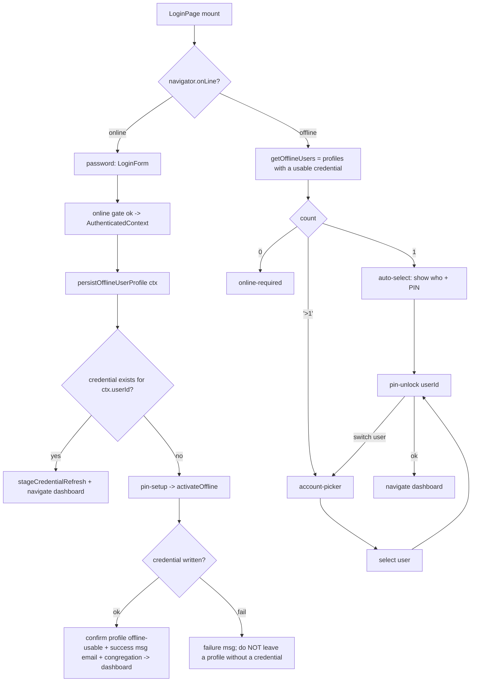
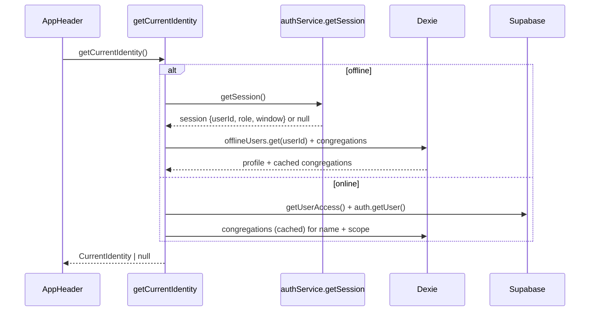

# Design Document

## Overview

The offline experience is single-user and identity-blind after unlock. This design adds a
per-user **offline user profile** store, a single **offline-aware identity resolver**, a
**multi-user account picker** in the offline login flow, and a **header refactor** that reads from
the resolver instead of calling Supabase directly.

The guiding principle (Decision D1): the existing `credentials` store + `src/services/crypto.ts`
remain the sole owner of PIN material and verification. The new profile store holds only
non-secret display/scope data and is joined to a credential by `userId`. Congregation names are
already cached in the Dexie `congregations` store; this design captures the user's `congregation_id`
and `scope_level` (which online login currently discards) so the name and scope can be resolved
offline.

### Goals

- Persist each user's profile (email, role, initials, congregation id + name, scope) on online login.
- Offline: list all users with a usable credential, let the operator pick one, and unlock per-user.
- After unlock, hydrate identity so the header shows initials, email, role, congregation name, and a
  correct (non-zero) scope.
- Preserve everything delivered by `offline-pin-flow-fix` and the capture/sync surfaces.

### Non-Goals

- No server schema changes, no crypto changes, no capture-form/repo/sync-engine changes.
- No change to the online login gate (Turnstile -> auth -> active access -> HO district).
- No change to HO district-scope header behavior (admin is online-only).

## Architecture

### Current flow (post offline-pin-flow-fix)

- `LoginForm` runs the online gate and hands an `AuthenticatedContext` to `LoginPage`.
- `LoginPage` is a mode machine: `loading | password | pin-setup | pin-unlock | online-required`.
  Offline it resolves `syncMeta.lastActiveUserId` -> if that user has a credential -> `pin-unlock`
  (targeting that `userId`); else -> `online-required`.
- `authService` owns `credentials` (PIN hash + HMAC), `unlockOffline(pin, userId?)`, the in-memory
  `OfflineSession` (userId, role, access window), and `lastActiveUserId`.
- `AppHeader` and dashboards call `getUserAccess()` -> `supabase.auth.getUser()` (fails offline).

### Target flow



### Identity resolution

A single resolver, `getCurrentIdentity()`, becomes the source of truth for the header (and any
screen that needs display identity). It is online-aware:



Fail-closed: offline with no active session -> `null` -> header renders nothing and the route guard
redirects to login (unchanged behavior).

## Components and Interfaces

### 1. Dexie schema (`src/db/schema.ts`) - version bump to v3

New interface and store. Adding a store requires a Dexie version bump; it is additive (no data
migration, no change to existing stores or the HMAC-protected credential set).

```ts
export interface OfflineUserProfile {
  userId: string;              // pk; matches CachedCredential.userId
  email: string;
  role: Role;
  displayName: string;         // email prefix, capitalized (same rule as today)
  initials: string;            // first two chars of displayName, uppercased
  congregationId: string | null;
  congregationName: string | null; // denormalized so it survives even if congregations cache is cleared
  scopeLevel: HierarchyLevel;
  hierarchyId: string | null;
  lastSyncAt: string;          // ISO; refreshed on each online login
}
```

```ts
offlineUsers!: Table<OfflineUserProfile, string>;
// ...
this.version(3).stores({ offlineUsers: "userId" });
```

### 2. Capture profile data at online login (`src/features/auth/LoginForm.tsx`)

The access query currently selects `role, status, start_date, end_date`. Extend it to also select
`congregation_id, hierarchy_id, scope_level`, and add these to `AuthenticatedContext`:

```ts
export interface AuthenticatedContext {
  userId: string;
  email: string;
  password: string;
  role: Role;
  turnstileToken: string | null;
  accessStartDate: string | null;
  accessEndDate: string | null;
  congregationId: string | null;   // new
  hierarchyId: string | null;      // new
  scopeLevel: HierarchyLevel;      // new
}
```

The online gate, ordering, and fail-closed sign-outs are otherwise unchanged.

### 3. Profile persistence (`src/services/authService.ts`)

```ts
export async function persistOfflineUserProfile(input: {
  userId: string; email: string; role: Role;
  congregationId: string | null; hierarchyId: string | null; scopeLevel: HierarchyLevel;
}): Promise<void>
```

- Computes `displayName` (capitalized email prefix) and `initials` (first two chars) using the SAME
  rule the header uses today, so "treasurer@..." -> "Treasurer"/"TR".
- Resolves `congregationName`: prefer `db.congregations.get(congregationId)`; if absent and online,
  fall back to a Supabase `congregations` lookup by id. **If the name cannot be resolved, log a
  warning and fall back to `congregationId` (or null when there is no congregation); never block the
  login (R1.4).**
- The congregation-cache ensure step (populating `congregations`) is performed **silently in the
  background** - it logs on failure but shows **no success toast** for the caching operation itself
  (R1.3).
- Upserts (`db.offlineUsers.put`) keyed by `userId` with `lastSyncAt = now`. Per-user write only;
  never touches other users' rows (R1.6, R1.8). To support the optional first-time confirmation
  (below), the function reads whether an `offlineUsers` row already existed for `userId` **before**
  the upsert and returns that fact to the caller:

```ts
export async function persistOfflineUserProfile(input: { ... }): Promise<{ firstTimeCached: boolean }>
```

- **First-time-only confirmation (R1 2a, MAY, optional):** when the upsert succeeds AND
  `firstTimeCached` is true (no prior row existed before this upsert), the caller MAY show a subtle,
  non-blocking confirmation such as "Offline access enabled for <congregationName>". It MUST NOT be
  shown on subsequent logins for the same `userId` on this device (gated on the pre-upsert existence
  check), so repeated logins do not spam the user. This is distinct from the R3.6 PIN-set
  confirmation (that fires only when a credential is written in the `pin-setup` path).
- Non-fatal: wrapped so a failure logs and returns without blocking login (R1.4).

Called from `LoginPage.handleAuthenticated` on every successful online login (before the
credential-exists branch), so the profile is fresh whether or not a PIN is set this session.

`autoRefreshReferenceCache()` (already invoked in `handleAuthenticated`) continues to populate the
`congregations` store, satisfying R1.2; the denormalized `congregationName` on the profile is the
offline-robust fallback.

### 4. Offline user list (`src/services/authService.ts`)

```ts
export async function getOfflineUsers(): Promise<OfflineUserProfile[]>
```

- Reads all `offlineUsers`, filters to those with a matching row in `credentials` (a *usable* cached
  credential, R2.7), sorts by `lastSyncAt` desc. Pure Dexie reads; no crypto, no network.

### 5. Identity resolver (`src/lib/identity.ts` - new)

```ts
export interface CurrentIdentity {
  userId: string;
  email: string;
  role: Role;
  displayName: string;
  initials: string;
  congregationId: string | null;
  congregationName: string | null;
  scopeLevel: HierarchyLevel;
  hierarchyId: string | null;
  scopeCount: number;
  isOnline: boolean;
}
export async function getCurrentIdentity(): Promise<CurrentIdentity | null>
```

- **Offline**: `authService.getSession()` -> if null, return null (fail-closed, R4.3). Else
  `db.offlineUsers.get(session.userId)` for display/scope; `role`/window come from the session
  (authoritative post-unlock), display/congregation from the profile. `scopeCount` from
  `computeScopeCount(...)` over cached congregations.
- **Online**: `getUserAccess()` + `supabase.auth.getUser()` for email (unchanged online semantics,
  R4.4); resolve `congregationName` from the cached `congregations` store (fallback Supabase);
  `scopeCount` via `computeScopeCount`.
- All role usage flows through existing types/permission helpers; no raw role-string branching
  beyond the existing HO special-case (R4.5).

```ts
// Scope mirrors AppHeader's current logic but against the cached store offline.
async function computeScopeCount(a: { scopeLevel; hierarchyId; congregationId }): Promise<number> {
  if (a.scopeLevel === "Eldership" && a.hierarchyId)
    return (await db.congregations.where("eldership_id").equals(a.hierarchyId).count());
  if (a.congregationId) return 1;   // never 0 when a congregation is known (R6.1, R6.3)
  return 0;
}
```

### 6. Route guard enrichment (`src/lib/routeGuard.ts`)

`resolveAccess()` offline branch currently returns `congregation_id: null`. Enrich it from the
profile so downstream `UserHierarchyAccess` consumers get the real `congregation_id`,
`hierarchy_id`, and `scope_level`:

```ts
const session = getSession();
if (!session) return null;
const profile = await db.offlineUsers.get(session.userId);
return {
  id: "offline-session", user_id: session.userId, role: session.role,
  hierarchy_id: profile?.hierarchyId ?? "",
  congregation_id: profile?.congregationId ?? null,
  scope_level: profile?.scopeLevel ?? "Congregation",
  status: "active", start_date: session.accessStartDate, end_date: session.accessEndDate,
};
```

### 7. Login UI (`src/features/auth/LoginPage.tsx`) + account picker

Extend the mode machine with `account-picker` and a `selectedUser` for the single/auto case:

```ts
type Mode = "loading" | "password" | "pin-setup" | "pin-unlock" | "online-required" | "account-picker";
```

Offline initial-mode effect (replaces the `lastActiveUserId`-only resolution; the pointer is still
used only to pre-select/sort):

```
users = await getOfflineUsers()
if (users.length === 0) -> online-required
else if (users.length === 1) -> set unlockUserId = users[0].userId; mode = pin-unlock (confirmation variant)
else -> mode = account-picker
```

New component `src/features/auth/AccountPicker.tsx`:

```ts
interface AccountPickerProps {
  users: OfflineUserProfile[];
  onSelect: (userId: string) => void;   // -> sets unlockUserId, mode = pin-unlock
  onUsePassword: () => void;             // "Sign in online instead"
}
```

- Renders "Choose an account to unlock" and a button per user: initials avatar, email,
  congregation name, and "Last synced <relative time>" (R2.1, R2.2). Accessible: each row is a
  labeled `button`; list has an accessible name.

`PinUnlock` (already takes `userId` from the flow-fix) gains a small header showing who is being
unlocked ("Unlock as <email> - <congregationName>") and a **Switch user** link
(`onSwitchUser -> mode = account-picker`) shown when more than one offline user exists (R2.3, R2.6).
It calls `unlockOffline(pin, userId)` exactly as today (per-user targeting, lockout preserved) (R3).

#### PIN-set feedback and ordering (`pin-setup` mode, R3.6 / R3.7)

The `pin-setup` mode is where a signed-in user establishes their offline PIN by calling
`authService.activateOffline(...)` (which writes the `credentials` row). This design adds explicit
user feedback and tightens the write ordering so the picker invariant (R2.7) holds. No crypto and no
credential-schema change is involved - this is UI feedback plus call ordering only.

- **On success** (credential written): show a confirmation that includes the user's **email and
  congregation name** per R3.6, e.g. "Offline PIN set for treasurer@bosmont.test - Bosmont. You can
  now work offline." The congregation name comes from the just-persisted profile / resolved context;
  if unresolved it falls back to the congregation id or is omitted, consistent with R1.4.
- **On failure** (e.g. the `credentials` write throws): show the failure message per R3.7, e.g.
  "Failed to set offline PIN. Please try again while online.", and ensure **no offline user profile
  is left without a usable credential** (see ordering below). Stay in a state that lets the user
  retry while online rather than navigating to the dashboard as "offline-ready".
- **Messaging mechanism:** prefer the project's existing toast system if one exists - the implementer
  should check for a `useToast` / `toast` util under `@/components/ui` (shadcn pattern). **If no toast
  util exists, fall back to a simple inline message block** rendered in the `pin-setup` UI with
  `role="alert"` and `aria-describedby` wiring consistent with the existing error blocks. Both the
  success and failure messages use the same chosen mechanism.

**Ordering to satisfy R3.7 + R2.7 jointly.** `persistOfflineUserProfile` runs on online login (before
the credential-exists branch), so a profile row may already exist by the time `pin-setup` runs. The
account picker (`getOfflineUsers`) already filters to profiles that have a matching `credentials` row
(R2.7), so a profile with no credential is never offered for offline unlock. In the `pin-setup` path:

- The profile is treated as **offline-usable only after `activateOffline` succeeds** (the credential
  is what makes it unlockable). Navigate to the dashboard and show the R3.6 success message only on a
  successful credential write.
- If `activateOffline` fails, do **not** navigate as offline-ready and do **not** persist a credential;
  because `getOfflineUsers` requires a matching credential, any pre-existing profile row without a
  credential is already excluded from the picker, so the R2.7 invariant holds without a separate
  rollback. (If the implementation chose to write the profile only inside this path, it MUST roll back
  / skip the profile write on credential failure.) The net rule: **no code path leaves a profile that
  `getOfflineUsers` would list without a usable credential.**

### 8. Header refactor (`src/components/AppHeader.tsx`)

Replace the `getUserAccess()` + `supabase.auth.getUser()` + direct congregation count query with a
single `getCurrentIdentity()` call:

- Avatar initials from `identity.initials` (never "." / blank) (R5.1).
- Dropdown shows `identity.email` and `identity.role` (R5.2).
- Congregation name rendered next to "OAC Management System" (left cluster) in both states (R5.3).
- Banner: `Role: <role>` and `Scope: <scopeCount> Congregation(s)` from identity (R5.4, R6).
- HO branch: keep the existing district-name display; for HO the identity still provides role, and
  the district fetch stays online-only (R6.4). No Supabase identity/scope calls while offline (R5.5).

## Data Models

| Store | Key | New? | Purpose |
|-------|-----|------|---------|
| `offlineUsers` | `userId` | yes (v3) | Non-secret per-user display/scope profile |
| `credentials` | `userId` | no | PIN hash + HMAC (unchanged; owner of PIN material) |
| `congregations` | `id` | no | Already caches `{id,name,code,eldership_id,...}` used for name + scope |
| `syncMeta` | `key` | no | `lastActiveUserId` used to pre-select/sort the picker |

Join key across `offlineUsers` <-> `credentials` is `userId`. A profile is only offered for offline
unlock when a credential row exists for the same `userId`.

## Error Handling

- Profile persistence failure at login: logged, non-fatal; login proceeds (R1.4). The header may
  show a reduced identity until the next successful online login.
- Congregation-cache ensure step: runs silently in the background with no success toast (R1.3); a
  failure is logged only and never blocks login.
- Congregation name unresolvable at persist time: log a warning, do not block login, store
  `congregationName` as the `congregationId` or null (R1.4).
- First-time offline caching (R1 2a, optional): a subtle "Offline access enabled for <congregation>"
  confirmation MAY be shown only the first time a `userId` is cached on this device (gated on the
  pre-upsert existence check); it is never shown on repeat logins.
- PIN-set success (`pin-setup`, R3.6): after `activateOffline` writes the credential, show a success
  message including the user's email and congregation name, then navigate to the dashboard.
- PIN-set failure (`pin-setup`, R3.7): if `activateOffline` fails, show "Failed to set offline PIN.
  Please try again while online.", remain in a retry-while-online state, and ensure no offline-usable
  profile is left without a credential (the picker's credential filter enforces this; roll back any
  profile write made solely in this path).
- Offline, no active session: `getCurrentIdentity()` returns null; header renders nothing; route
  guard redirects to login (fail-closed, R4.3).
- Offline, profile missing for an unlocked user (e.g. credential present but profile not yet
  written): header falls back to session role + email-derived initials if available, else a minimal
  identity; scope resolves via cached congregations if `congregationId` is known, else 0 (does not
  crash).
- Picker: only lists users with a usable credential; a profile without a credential is skipped
  (R2.7). Zero usable users -> online-required (R2.4).
- Congregation name unresolved (not cached and offline): header shows role + scope without a name
  rather than erroring.

## Correctness Properties

These invariants drive the property-based tests in the Testing Strategy. `X` denotes an arbitrary
generated scenario (a set of offline profiles, credentials, cached congregations, a connectivity
flag, and a selected user + PIN).

### Property 1: Profile fidelity
After a successful online login for user U, `offlineUsers.get(U)` reflects U's
email/role/congregation/scope and a fresh `lastSyncAt`; a repeat login updates the same row (count
unchanged). 
**Validates: Requirements 1.1, 1.3**

### Property 2: No secret leakage
No field of any `offlineUsers` row is or is named for a PIN, PIN hash, salt, or HMAC; PIN material
exists only in `credentials`. 
**Validates: Requirements 1.5**

### Property 3: Isolation
Any write for user U (profile upsert, unlock, lockout) leaves every other user's `offlineUsers` and
`credentials` rows unchanged. 
**Validates: Requirements 1.6, 3.3**

### Property 4: Picker partition and credential-backed listing
For `n` users with a usable credential, the offline entry screen is `online-required` iff `n == 0`,
an auto-selected confirmation iff `n == 1`, and the account picker iff `n > 1`. A profile without a
credential is never listed. Moreover, for **any** sequence of profile upserts and PIN-set attempts
(including a failed `activateOffline`), `getOfflineUsers()` lists exactly the profiles that have a
matching usable credential - so a failed PIN-set never produces an offline-usable profile without a
credential. 
**Validates: Requirements 2.1, 2.2, 2.3, 2.4, 2.7, 3.7**

### Property 5: Targeted unlock
Selecting user A and submitting A's correct PIN unlocks A regardless of store order; submitting a
wrong PIN fails, increments only A's failed-attempt counter, and never unlocks any other user. The
lockout threshold is identical to `offline-pin-flow-fix`. 
**Validates: Requirements 3.1, 3.2, 3.3, 3.4**

### Property 6: Fail-closed identity
`getCurrentIdentity()` returns null whenever offline with no active session; it never returns a
populated identity for a user who has not unlocked. 
**Validates: Requirements 4.1, 4.3**

### Property 7: Scope soundness
`scopeCount >= 1` whenever a congregation is known for the user (profile `congregationId` set, or an
Eldership scope with >= 1 cached congregation); it is never 0 in that case. 
**Validates: Requirements 6.1, 6.2, 6.3**

### Property 8: Online parity
With connectivity on, identity/role/scope resolution yields the same role and congregation count as
the pre-change online behavior (no online regression). 
**Validates: Requirements 4.4**

### Property 9: Preservation
The `offline-pin-flow-fix` explore and preservation suites continue to pass unchanged. 
**Validates: Requirements 7.2, 8.3**

## Testing Strategy

Reuse the existing Vitest + fake-indexeddb + jsdom harness from `offline-pin-flow-fix`.

### Property / behavior coverage (R8.4)

1. **Profile persistence** (Property 1, 3): after a simulated online login, `offlineUsers.get(userId)`
   holds the expected email/role/initials/congregationId/congregationName/scopeLevel and a fresh
   `lastSyncAt`; a second login updates (not duplicates) the row; other users' rows are untouched.
2. **No secret leakage** (Property 2): assert no PIN/hash/salt/HMAC field or value on any profile row.
3. **Picker visibility** (Property 4): property over N in {0,1,>1} usable users ->
   {online-required, auto-select confirmation, account-picker}. Profiles without a credential are
   never listed. Includes the R3.7 case: after a profile upsert followed by a failed PIN-set (no
   credential written), that profile is not listed by `getOfflineUsers`.
4. **Per-user unlock** (Property 5): with userB sorted first, selecting userA and entering userA's
   PIN unlocks userA; a wrong PIN fails and does not unlock userB; lockout threshold preserved.
5. **Identity hydration / scope** (Property 6, 7): given an offline session + profile,
   `getCurrentIdentity()` yields correct initials/role/email/congregationName and `scopeCount >= 1`
   when a congregation is cached; returns null with no session.
6. **Online parity** (Property 8): with connectivity on, resolved role + scope count match the
   pre-change behavior.

### Manual QA (acceptance scenario)

Follow the requirements "Acceptance Scenario" with two treasurers on one device.

### Quality gates (R8.1-R8.3, Property 9)

`tsc --noEmit` clean; `vite build` succeeds; `offlinePinFlow.explore` and
`offlinePinFlow.preservation` still pass.

## Guardrails and Files Touched

**Modify**: `src/db/schema.ts` (add store, v3), `src/features/auth/LoginForm.tsx` (context fields),
`src/services/authService.ts` (profile persist + `getOfflineUsers`), `src/lib/identity.ts` (new),
`src/lib/routeGuard.ts` (offline enrichment), `src/features/auth/LoginPage.tsx` (mode machine),
`src/features/auth/AccountPicker.tsx` (new), `src/components/AppHeader.tsx` (read identity).

**Do NOT touch**: `src/services/crypto.ts`, `src/components/CashbookForm.tsx`,
`src/db/captureRepo.ts`, `src/utils/syncEngine.ts`. No new runtime crypto dependency; no server-side
pin-hash column; no writes to `auth.users`/`profiles` (R7.3, R7.4).

**Invariants preserved**: permission gate as single source of truth; fail-closed auth; offline
session provisional (RLS + reconnect re-validation authoritative); PIN material only in
`credentials` + crypto; per-user writes never affect other users.

## Requirements Traceability

| Requirement | Addressed by |
|-------------|--------------|
| R1 Persist profile | Components 2, 3; schema v3; Property 1, 2, 3 |
| R1.3 Silent congregation cache | Component 3 (silent background ensure, no success toast); Error Handling |
| R1.4 Name-resolution fallback | Component 3 (`congregationName` -> id/null, warn, non-blocking); Error Handling |
| R1 2a First-time confirmation (MAY) | Component 3 (`firstTimeCached` gate); Error Handling |
| R2 Account picker | Component 7 (LoginPage + AccountPicker), `getOfflineUsers`; Property 4 |
| R3 Per-user unlock | Component 7 PinUnlock + existing `unlockOffline(pin, userId)`; Property 5 |
| R3.6 PIN-set success message | Component 7 (`pin-setup` success, email + congregation); Error Handling |
| R3.7 PIN-set failure + no orphan profile | Component 7 (`pin-setup` failure + ordering), `getOfflineUsers` credential filter; Property 4; Error Handling |
| R4 Identity hydration | Component 5 `getCurrentIdentity`, Component 6 route guard; Property 6, 8 |
| R5 Header identity | Component 8 |
| R6 Scope count | Component 5 `computeScopeCount`, Component 8; Property 7 |
| R7 Preserve behavior | Guardrails; no-touch list; reuse flow-fix; Property 9 |
| R8 Quality gates | Testing Strategy |

> Note: R3.6, R3.7, and the R1.3/R1.4/R1 2a clarifications are **UI-feedback additions** (success/
> failure messaging and silent-vs-subtle confirmations) plus call ordering. They introduce **no
> change to `src/services/crypto.ts` and no change to the `credentials` schema**; the messaging lives
> in the `LoginPage` / `pin-setup` UI and `authService` return value.

